# Central Intelligence Platform Audit — 01. Executive Summary

**Project:** Central Intelligence (Aevum CI Brain)  
**Repository:** `https://github.com/Aashish-RC/Central-Intelligence`  
**Audit Baseline:** Commit `138b95b` on branch `main`  
**CI Baseline:** GitHub Actions Run `43480953326` (Status: Green / Passing)  
**Audit Date:** November 2026  
**Auditor Roles:** Principal Software Architect, Senior Engineering Reviewer, Security Auditor, QA Lead & Release Engineer  
**Audit Scope:** Read-Only Full Platform Audit across all 19 Architectural Layers, all subprojects, dependencies, Docker Compose services, tests, security boundaries, and operational runbooks.

---

## 1. Executive Verdict & Core Paradox

> **CRITICAL VERDICT: NOT PRODUCTION READY**  
> While the repository exhibits a green CI status, rigorous static typing, hash-pinned Python lockfiles, and 2,615 passing test cases across 402 test files, a profound **operational gulf** exists between the declared architecture in documentation and the actual implementation on disk.

Central Intelligence suffers from what this audit identifies as the **"Simulated CI Paradox"**:
1. **The Green CI Illusion:** The continuous integration pipeline runs entirely against in-memory dictionary mocks, hermetic RAM stores, and simulated responses. 
2. **Disconnected Live Infrastructure:** Although `docker-compose.yml` orchestrates 29 open-source container services (Keycloak, OpenFGA, Infisical, Lago, OpenMeter, SigNoz, Bytebase, Temporal, etc.), **over 57% of the platform's adapters never initiate network calls to these containers**, even when configured with `ADAPTER_MODE=live`.
3. **Flawed Crown Jewel Defense:** The central safety mechanism (`control/safety/production_guard.py`) intended to halt execution if simulated drivers run in production contains a fatal environment variable naming defect (`ENV` vs `ENVIRONMENT`), while 19 out of 33 adapter files import `fail_closed_in_production` but **never execute it**.
4. **Data Loss on Process Restart:** Core operational state—including user credentials in KeycloakAdapter, authorization tuples in OpenFGAAdapter, active secrets in InfisicalAdapter, billing subscriptions in LagoAdapter, and token counters in OpenMeterAdapter—is stored exclusively in ephemeral Python memory dictionaries (`dict` and `set`). A container crash or pod restart wipes all tenants, secrets, permissions, and billing balances.

Despite these critical integration gaps, the codebase contains **impressive foundational assets**:
- An industrial-grade, multi-provider AI Model Gateway in TypeScript (`cognitive/reasoning/`, ~23,000 LOC) with comprehensive token bucket rate-limiting, session affinity, cooldowns, and MoA fusion.
- A mathematically rigorous, append-only Merkle tree audit ledger (`control/safety/audit/ledger.py`) with SHA-256 hash chains and cryptographic tamper verification.
- An advanced Dual-Boundary Context Assembler (`control/context/trust/boundary_assembler.py`) with delimiter breakout protection and injection signature scanning.
- Exemplary supply-chain hygiene (`scripts/check_licenses.py`) enforcing hash-pinned dependencies and quarantining AGPL-3.0 services behind private Docker networks.

---

## 2. 19-Layer Architecture & Plane Rollup

The repository defines 19 architectural layers organized across 4 primary planes (verified via `docs/architecture.md` and subsystem `README.md` manifests):

```mermaid
flowchart TD
    subgraph Plane4["Plane 4: Surface & Federation (L18 - L19)"]
        L18["L18: Interaction (Web, Desktop, Terminal, IDE)"]
        L19["L19: Specialization & Federation (Brain Factory, Huly PM, Sync)"]
    end

    subgraph Plane2["Plane 2: Control & Safety Plane (L9 - L14)"]
        L09["L9: Context Engineering (Dual Boundary, Compaction)"]
        L10["L10: Safety & Trust (PII Scrubber, Merkle Audit, Guardrails)"]
        L11["L11: Evaluation & Quality (Hallucination, Drift, Phoenix)"]
        L12["L12: Identity & IAM (Keycloak OIDC, OpenFGA ReBAC, Infisical)"]
        L13["L13: Billing & Metering (OpenMeter, Lago, Hyperswitch)"]
        L14["L14: Observability (SigNoz APM, PostHog, Uptime Kuma)"]
    end

    subgraph Plane1["Plane 1: Cognitive Plane (L1 - L8)"]
        L01["L1: Perception (LiveKit, Whisper, PaddleOCR, Crawl4AI)"]
        L02["L2: Memory Hierarchy (3-Tier Fused Memory, Letta/Mem0)"]
        L03["L3: Knowledge & Retrieval (Hybrid RAG, BM25, Qdrant, AGE)"]
        L04["L4: Reasoning & Planning (Multi-Model Gateway, Goals, MoA)"]
        L05["L5: Action & Tools (Agent Runner, E2B Sandbox, Nango Connectors)"]
        L06["L6: Output Generation (Generative UI, Canvas, C2PA Watermark)"]
        L07["L7: Learning & Adaptation (RL Weights, Skills Packaging, Cognee)"]
        L08["L8: Orchestration (Multi-Step Planner, DAG Runner, Temporal)"]
    end

    subgraph Plane3["Plane 3: Platform Infrastructure (L15 - L17)"]
        L15["L15: Data & Messaging (Supabase Postgres, Dragonfly, AutoMQ)"]
        L16["L16: Compute & Model Serving (Carbon Routing, Hot-Swap)"]
        L17["L17: Release & Lifecycle (Kamal Blue/Green, Bytebase Migrations)"]
    end

    Plane4 --> Plane2
    Plane2 --> Plane1
    Plane1 --> Plane3
```

### Overall Completion Scorecard

Scoring uses an objective 4-pillar model:
- **Core Domain Logic & Spec (30% weight)**
- **External Integration & Wire Binding (30% weight)**
- **Security, Multi-Tenancy & Governance (20% weight)**
- **Verification & Operational Testing (20% weight)**

| Plane | Layers Included | Total LOC | Total Test Files | Declared Status | Functional Completeness | Operational Readiness | Confidence |
| :--- | :--- | :---: | :---: | :--- | :---: | :---: | :---: |
| **Cognitive Plane** | L1 – L8 | 198,623 | 280 | "Built / Hardened" | **71.2%** | **52.0%** | HIGH |
| **Control & Safety Plane** | L9 – L14 | 36,969 | 79 | "Complete" | **63.0%** | **34.0%** | HIGH |
| **Platform Infrastructure** | L15 – L17 | 8,120 | 34 | "Production Ref" | **52.3%** | **28.0%** | HIGH |
| **Surface & Federation** | L18 – L19 | 3,890 | 17 | "Production Ref" | **52.0%** | **22.0%** | HIGH |
| **TOTAL / PLATFORM** | **L1 – L19** | **247,602** | **410** | **"Production Ready"** | **63.5%** | **38.5%** | **HIGH** |

*Note: Functional Completeness measures codebase structure, schemas, and in-memory execution logic. Operational Readiness measures whether the system functions when bound to live container backends and surviving restarts.*

---

## 3. High-Priority Findings Matrix

| Finding ID | Severity | Layer | Title | Repository Location | Verified Impact |
| :--- | :---: | :---: | :--- | :--- | :--- |
| **F-SEC-01** | **P0** | L10 | **Production Guard Bypassed via Environment Variable Discrepancy** | `control/safety/production_guard.py#L30-L32`, `docs/DEPLOYMENT.md#L33` | Docs instruct `ENV=production`, but code checks `ENVIRONMENT=production`. Insecure mocks execute in production without error. |
| **F-INT-01** | **P0** | L12 | **OpenFGA Zanzibar ReBAC Never Connects to Container** | `control/identity/openfga_adapter.py#L69-L73` | ReBAC is a local in-memory Python set. No HTTP calls to `openfga:8081`. Tuples vanish on process restart. |
| **F-INT-02** | **P0** | L12 | **Infisical Secret Vault Stores Keys Plaintext in RAM** | `control/identity/secrets/infisical_adapter.py#L85` | Zero network calls to Infisical KMS. Master secrets and BYOK credentials lost on container restart. |
| **F-INT-03** | **P0** | L13 | **Billing Engine (Lago) Never Issues HTTP Requests** | `control/billing/engine/lago_adapter.py#L19`, `#L75-L77` | Imports `httpx` but never invokes it. Monthly quotas and plan entitlements evaluated in-memory only. |
| **F-INT-04** | **P0** | L13 | **Hyperswitch Payment Failures Silently Swallowed** | `control/billing/payments/hyperswitch_adapter.py#L140-L159` | Catches live payment HTTP exceptions with `pass` and falls back to in-memory success. Uncharged transactions. |
| **F-INT-05** | **P0** | L14 | **SigNoz OpenTelemetry Adapter Disconnected from OTLP** | `control/observability/signoz/signoz_adapter.py#L47-L50` | Spans and metrics appended to Python list. Zero OTLP gRPC/HTTP export to `signoz:4317`. |
| **F-INT-06** | **P0** | L15 | **Supabase Adapter Does Not Connect to PostgreSQL** | `platform_infra/data/supabase/supabase_adapter.py#L57-L65` | Implements table storage, pgvector cosine search, and AGE graph queries in pure Python dictionaries. |
| **F-OPS-01** | **P0** | L17 | **Kamal Deployment Adapter is a Synthetic State Machine** | `platform_infra/release/ci/kamal_adapter.py#L90-L120` | Does not invoke `kamal` CLI or Docker daemon; sequences strings in RAM. Zero actual deployment automation. |
| **F-OPS-02** | **P0** | L17 | **Bytebase Database Migration Adapter Does Not Run DDL** | `platform_infra/release/db/bytebase_adapter.py#L128-L137` | Splits SQL strings by semicolon in memory; does not connect to database or execute migrations. |
| **F-SEC-02** | **P1** | L10 | **19 of 33 Adapters Import `fail_closed_in_production` but Never Call It** | Codebase-wide AST scan | Adapters across Perception, Billing, Observability, and Storage silently fall back to mock data in live mode. |
| **F-INT-07** | **P1** | L8 | **Temporal Adapter Checkpoints to Local JSON File** | `control/orchestration/workflow_builder/runtime/temporal_adapter.py#L78` | Bypasses live Temporal server; persists execution history to local `.temporal_checkpoints/` disk folder. |
| **F-INT-08** | **P1** | L5 | **E2B Sandbox Returns Hardcoded Mock Strings** | `cognitive/action/agent/sandbox/e2b_adapter.py#L65-L71` | Commands like `Fibonacci(10)` in test suites are never executed; mock string with exit code 0 returned. |
| **F-DEP-01** | **P1** | L1, L2, L15 | **Missing Mandatory Python Dependencies in Live Mode** | `cognitive/perception/vision/paddleocr_adapter.py`, `cognitive/memory/tiers/facts/postgres_adapter.py` | `paddleocr`, `faster-whisper`, `psycopg2`, and `confluent-kafka` missing from lockfile; fail closed in live mode. |
| **F-DOC-01** | **P2** | L9 | **Dual-Boundary Tag Documentation Discrepancy** | `control/context/trust/untrusted_sandbox.py#L25`, `docs/SECURITY_REVIEW.md#L73` | Code uses `<untrusted_content source="..." trust="...">`, docs claim `<untrusted_user_input hash="...">`. |

---

## 4. Key Strengths and Architectural Highlights

1. **Crown Jewel Model Gateway (Layer 4):**
   `cognitive/reasoning/` is a production-grade TypeScript AI gateway. It features robust circuit-breaking, cooldown algorithms, token-bucket rate limiting, dynamic prompt routing (OpenAI, Anthropic, Gemini, Bedrock, Ollama), CEL condition evaluation, and MoA (Mixture of Agents) aggregation.
2. **Cryptographic Merkle Audit Ledger (Layer 10):**
   `control/safety/audit/ledger.py` implements an append-only, tamper-evident audit log backed by SQLite and SHA-256 hash chains. Any unauthorized data alteration invalidates the root Merkle hash (`verify_integrity()` returns false).
3. **Dual-Boundary Injection Defense (Layer 9):**
   `control/context/trust/boundary_assembler.py` cleanly separates high-trust system prompts from low-trust retrieved context and tool outputs, escaping nested XML closing tags to prevent prompt injection breakouts.
4. **License and Supply-Chain Enforcement:**
   `scripts/check_licenses.py` strictly prevents copyleft contamination by validating all 29 Docker services, enforcing digest-pinned container tags, and ensuring AGPL-3.0 services (Lago) remain isolated across network boundaries.

---

## 5. Release Gate Verdict & Action Plan

### Release Decision: **BLOCK RELEASE (NO-GO)**

Central Intelligence v1.0.0 cannot be deployed to production in its current state. Attempting live deployment under `ADAPTER_MODE=live` will trigger cascade failures:
- Missing dependencies (`faster-whisper`, `paddleocr`, `psycopg2`, `confluent-kafka`) will halt startup.
- In-memory adapters will fail to synchronize with live Docker containers.
- Process termination will result in catastrophic loss of user identities, API keys, and billing records.

### Four-Phase Remediation Roadmap

1. **Milestone 1 (P0 Critical — 2-3 Weeks):**
   - Fix `ENV` vs `ENVIRONMENT` defect in `production_guard.py`.
   - Wire `fail_closed_in_production()` across all 19 non-compliant adapters.
   - Resolve dependency lockfile gaps (`psycopg2-binary` / `pg8000` alignment, `faster-whisper`).
2. **Milestone 2 (P1 Core Infrastructure Wiring — 3-4 Weeks):**
   - Replace in-memory dictionaries in `OpenFGAAdapter` with live HTTP REST/gRPC calls to `openfga:8081`.
   - Wire `InfisicalAdapter` to live Infisical KMS REST API.
   - Wire `OpenMeterAdapter` and `LagoAdapter` to live HTTP endpoints.
   - Wire `SigNozAdapter` to OpenTelemetry OTLP collector (`signoz:4317`).
3. **Milestone 3 (P1 Execution & Storage Hardening — 3-4 Weeks):**
   - Connect `SupabaseAdapter` to real PostgreSQL database connections.
   - Wire `TemporalWorkflowAdapter` to live Temporal gRPC client (`localhost:7233`).
   - Implement real container isolation for tool execution (Local Docker / E2B cloud).
4. **Milestone 4 (P2 Surface & Federation Polish — 2-3 Weeks):**
   - Build live HTTP reverse proxy between LibreChat and Central Intelligence API.
   - Replace synthetic Kamal/Bytebase scripts with actual CLI/Docker runners.
   - Verify full stack with end-to-end un-mocked container integration testing.

---

*Reports 02 through 10 provide complete, exhaustive evidence, layer-by-layer audits, code citations, and implementation roadmaps.*
