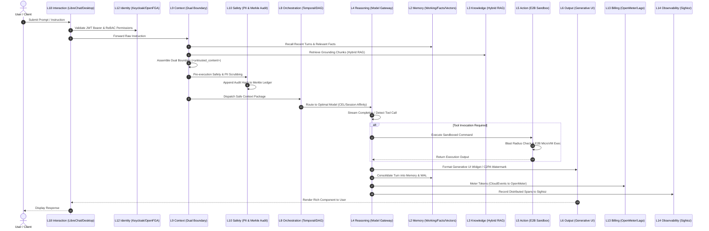

# Central Intelligence Platform Audit — 02. Architecture & Dependencies

**Baseline:** Commit `138b95b` on branch `main`  
**CI Baseline:** GitHub Actions Run `43480953326`  
**Scope:** Structural architecture discovery, package inventory, service entry points, Docker Compose topology, data flows, and declared vs implemented comparison.

---

## 1. The 19 Architectural Layers & 4 Primary Planes

Central Intelligence defines its architecture across 19 numbered layers organized into 4 primary planes (verified in `docs/architecture.md`, subsystem `README.md` files, and `docs/FEATURE_AUDIT.md`):

### Plane 1: Cognitive Plane (Layers 1–8)
Sensory perception, memory fusion, knowledge retrieval, multi-model reasoning, sandboxed action execution, multimodal output generation, continuous learning, and multi-agent workflow orchestration.
- **Layer 1: Perception** (`cognitive/perception/`) — Sensory front-end ingesting voice/audio (LiveKit, Whisper), vision/OCR (PaddleOCR, VLM), web/documents (Crawl4AI, Unstructured), screen state (Screenpipe), and accessibility drivers.
- **Layer 2: Memory Hierarchy** (`cognitive/memory/`) — 3-tier fused dynamic memory: Tier 1 ephemeral working memory with WAL, Tier 2 structured fact store (SQLite/PostgreSQL), and Tier 3 semantic dense vector store (Qdrant/Chroma), plus graph relations (Apache AGE/Memgraph).
- **Layer 3: Knowledge & Retrieval** (`cognitive/knowledge/`) — Global Hybrid Search combining sparse BM25 (Meilisearch) and dense vectors (Qdrant), Reciprocal Rank Fusion (RRF), GraphRAG, source provenance, and abstention gating.
- **Layer 4: Reasoning & Planning** (`cognitive/reasoning/`) — Unified AI Model Gateway written in TypeScript (Hono): multi-provider routing (OpenAI, Anthropic, Gemini, Bedrock, Ollama), CEL conditional routing, token bucket rate limits, MoA fusion, PRM verifiers, and debate orchestration.
- **Layer 5: Action & Tools Hub** (`cognitive/action/`) — Autonomous agent runtime (Phoenix), tool execution sandboxing (E2B Cloud MicroVMs, Local Docker), Nango connector integrations, browser automation, and blast radius simulation.
- **Layer 6: Output Generation & Multimodal Surfaces** (`cognitive/output/`) — Multimodal synthesis, Generative UI widgets (CopilotKit, Tiptap, Tldraw, Mermaid), document templating, C2PA watermarking, and surgical claim diff patching.
- **Layer 7: Learning, Memory & Continuous Adaptation** (`cognitive/learning/`) — Demonstration-based capability expansion, RL routing weight adjustments, synthetic dataset generation, consent and training lineage, and skills packaging marketplace.
- **Layer 8: Orchestration** (`control/orchestration/`) — Multi-agent coordination, multi-step DAG runner, ReAct execution loops, durable workflow checkpoints (Temporal), Paperclip agent fleet, and human-in-the-loop governance.

### Plane 2: Control & Safety Plane (Layers 9–14)
Context assembly, safety guardrails, continuous evaluation, identity and access control, billing and consumption metering, and distributed observability.
- **Layer 9: Context Engineering** (`control/context/`) — Dynamic prompt synthesis, token budget management, context compaction, cache prefix optimization, and the Dual-Boundary context assembler isolating untrusted content.
- **Layer 10: Safety, Trust & Privacy** (`control/safety/`) — 4-Tier PII scrubber, NeMo Guardrails safety policies, c15t consent management, minor safeguards, and the cryptographic append-only Unified Merkle Audit Ledger.
- **Layer 11: Evaluation & Quality** (`control/evaluation/`) — Hallucination detection, embedding drift monitoring, multi-agent scenario simulation, multi-pillar quality scoring, and Arize Phoenix / Langfuse integration.
- **Layer 12: Identity & Access Management (IAM)** (`control/identity/`) — Multi-tenant organization hierarchies, Keycloak OIDC/OAuth 2.1 authentication, Google Zanzibar ReBAC relationship tuples (OpenFGA), and zero-downtime secret vaults (Infisical).
- **Layer 13: Entitlements & Billing** (`control/billing/`) — Token consumption metering (OpenMeter), AGPL-quarantined subscription and plan management (Lago), universal payment processing (Hyperswitch), and BYOK credit allocation.
- **Layer 14: Observability** (`control/observability/`) — Distributed tracing, latency percentiles (P50/P90/P95/P99), error rate calculations, SigNoz OpenTelemetry collectors, PostHog product telemetry, and Uptime Kuma monitoring.

### Plane 3: Platform Infrastructure Plane (Layers 15–17)
Data persistence, messaging backbones, model compute optimization, and deployment release lifecycles.
- **Layer 15: Data & Messaging** (`platform_infra/data/`) — Unified relational persistence and pgvector (Supabase Postgres), Apache AGE graph data, in-memory caching and pub/sub (Dragonfly / Valkey), and serverless Kafka event streaming (AutoMQ).
- **Layer 16: Compute & Model Serving** (`platform_infra/compute/`) — Carbon-aware green routing, hardware tiering (CPU, GPU, TPU, NPU), model hot-swapping without dropped connections, provider health monitoring, and safe physical actuation.
- **Layer 17: Release & Lifecycle** (`platform_infra/release/`) — Kamal rolling zero-downtime container deployments, Bytebase database schema migration gates, GrowthBook feature flags, and automated canary rollout analysis.

### Plane 4: Surface & Federation Plane (Layers 18–19)
Cross-platform client interaction and decentralized multi-brain federation.
- **Layer 18: Interaction** (`surface/interaction/`) — Cross-platform user interfaces across Web (LibreChat), Desktop (Jan), CLI terminal (OpenCode), and IDE (Zed), unified via the Universal Surface Adapter.
- **Layer 19: Specialization & Federation** (`surface/federation/`) — Domain-specialized cognitive brains, Huly project management integration, differential privacy federated learning, and the Federated Brain Sync Protocol.

---

## 2. Package & Technology Inventory

```text
Central-Intelligence (Root)
├── Python Ecosystem (Python >= 3.10)
│   ├── pyproject.toml (Root setuptools build, test paths, ruff, mypy)
│   ├── requirements.txt (Top-level runtime dependencies)
│   ├── requirements.lock (129 sha256 hash-pinned packages compiled with uv)
│   └── 21 Subproject pyproject.toml files:
│       ├── cognitive/perception/voice_speech/pyproject.toml
│       ├── cognitive/perception/translation/pyproject.toml
│       ├── cognitive/memory/pyproject.toml
│       ├── cognitive/knowledge/pyproject.toml
│       ├── cognitive/knowledge/web_search/pyproject.toml
│       ├── cognitive/knowledge/search/pyproject.toml
│       ├── cognitive/action/agent/pyproject.toml
│       ├── cognitive/action/sandboxes/pyproject.toml
│       ├── cognitive/action/tools_mcp/pyproject.toml
│       ├── cognitive/action/browser_automation/pyproject.toml
│       ├── cognitive/action/remote_access/pyproject.toml
│       ├── cognitive/output/voice_speech/pyproject.toml
│       ├── cognitive/output/media_gen/pyproject.toml
│       ├── cognitive/learning/skills_packaging/pyproject.toml
│       ├── cognitive/learning/recommender/pyproject.toml
│       ├── control/safety/guardrails/pyproject.toml
│       ├── control/safety/rules/pyproject.toml
│       ├── control/evaluation/tracker/pyproject.toml
│       ├── control/orchestration/internal_agents/pyproject.toml
│       └── control/orchestration/orchestrator/pyproject.toml
│
├── TypeScript / Node.js Ecosystem (pnpm 10.30.3, Node.js 22+, Turbo 2.4.4)
│   ├── package.json (Root scripts: build, dev, test, test:reasoning, test:output)
│   ├── pnpm-workspace.yaml (Workspaces: 'cognitive/*', 'control/*')
│   ├── turbo.json (Monorepo pipeline: build, test, dev, lint)
│   ├── cognitive/reasoning/package.json (@central-intelligence/reasoning, Hono, Zod, Vitest)
│   ├── control/orchestration/package.json (@central-intelligence/orchestration, tsx, Vitest)
│   └── cognitive/output/package.json (@central-intelligence/output)
│
└── Go Ecosystem (Go 1.21+)
    └── control/evaluation/langfuse/go.mod (Langfuse fanout proxy gateway)
```

---

## 3. Service Entry Points & Network Topology

### Primary Service Entry Points
1. **Model Gateway (Layer 4):**
   - File: `cognitive/reasoning/src/core/server.ts`
   - Technology: Hono framework running on Node.js (`@hono/node-server`)
   - Default Port: `8787` (configurable via `PORT`)
   - Endpoints: `/v1/chat/completions`, `/v1/models`, `/v1/embeddings`, `/healthz`
2. **Context Engineering API (Layer 9):**
   - File: `control/context/server.py`
   - Technology: FastAPI / Uvicorn
   - Default Port: `8000`
   - Endpoints: `/v1/context/assemble`, `/v1/context/compact`, `/health`
3. **Agent Server & Execution API (Layer 5):**
   - File: `cognitive/action/agent/server/api.py`
   - Technology: FastAPI
   - Default Port: `8080`
   - Endpoints: `/agents`, `/agents/{agent_id}/run`, `/tools`, `/health`
4. **Knowledge Retrieval API (Layer 3):**
   - File: `cognitive/knowledge/rag_api/` (FastAPI bridge)
   - Endpoints: `/api/v1/search`, `/api/v1/documents/index`

### Docker Compose Service Topology (29 Services)

```mermaid
graph LR
    subgraph OSS_Default["OSI-Approved Default Stack"]
        QDR[qdrant:6333]
        MEI[meilisearch:7700]
        VAL[valkey:6379]
        TEM[temporal:7233]
        KC[keycloak:8085]
        FGA[openfga:8081]
        INF[infisical:8083]
        HYP[hyperswitch:8080]
        LK[livekit:7880]
        SUP[supabase-db:5432]
        AGE[apache-age:5433]
        KAF[kafka:9092]
        SVX[svix:8071]
        OM[openmeter:8888]
        SIG[signoz:4317]
        UK[uptime-kuma:3001]
        PH[posthog:8090]
        BB[bytebase:8080]
        LC[librechat:3080]
        HUL[huly:80]
        CHROMA[chroma:8000]
        OLLAMA[ollama:11434]
        OTEL[otel-collector:4317]
    end

    subgraph Non_OSI["Opt-In Non-OSI Stack (profiles: self-hosted-non-osi)"]
        FAL[falkordb:6379]
        MEMG[memgraph:7687]
        NAN[nango:3003]
        PHX[phoenix:6006]
        DF[dragonfly:6379]
    end

    subgraph AGPL_Quarantine["AGPL Quarantine Network (agpl_quarantine_net)"]
        LAGO[lago:3000]
    end
```



---

## 4. End-to-End Layer Dependency & Data Flow



---

## 5. Declared Architecture vs. Implemented Architecture

The following matrix contrasts what is documented across `docs/` against what actually exists in repository source code:

| Component / Layer | Declared Architecture (`docs/`) | Actual Implemented Architecture (Source Code) | Architectural Status |
| :--- | :--- | :--- | :---: |
| **L1 LiveKit Voice** | Live WebRTC streaming audio chunks to LiveKit server with sub-100ms latency. | Generates JWT token with `livekit.api`; appends chunks to in-memory Python list `_stream_buffer`. No WebRTC socket. | ⚠️ **Simulated Bridge** |
| **L1 Handy Whisper** | 100% offline local speech-to-text transcription via `faster-whisper`. | Fallback code exists, but `faster-whisper` is **not installed** in lockfile. Fails closed in live mode; tests mock it. | ⚠️ **Uninstalled Dep** |
| **L1 PaddleOCR** | High-precision printed and handwritten OCR extraction via PaddleOCR engine. | Code falls back to hardcoded string `"Central Intelligence System Authorization Badge 2026"`; `paddleocr` uninstalled. | ⚠️ **Stub / Mock** |
| **L2 Memory Hierarchy** | 3-tier fused architecture (WAL + SQLite/Postgres + Qdrant/Chroma + Apache AGE). | **Built & functional.** Working memory, SQLite facts, Qdrant vectors, and Apache AGE (via pg8000) are real. | ✅ **Built** |
| **L3 Hybrid RAG** | BM25 lexical + dense vectors with Reciprocal Rank Fusion (RRF) and permission filtering. | **Built & functional.** `LocalHybridSearchEngine` and `ReciprocalRankFusion` implement real rank math. | ✅ **Built** |
| **L4 Model Gateway** | Multi-provider streaming gateway with TPM limits, cooldowns, CEL routing, and MoA. | **Built & functional.** Production-grade TypeScript implementation (~23,000 LOC) with Vitest test coverage. | ✅ **Built** |
| **L5 E2B Sandbox** | Hardware-isolated cloud microVMs executing untrusted code safely. | When `e2b` package is uninstalled, catches import and returns hardcoded mock dictionary exit code 0. | ⚠️ **Simulated Fallback** |
| **L8 Temporal Workflow** | Durable workflow orchestration surviving server crashes and process restarts via Temporal server. | `TemporalWorkflowAdapter` saves JSON files to local `.temporal_checkpoints/` disk directory; ignores Temporal server. | ⚠️ **Local Simulation** |
| **L9 Dual Boundary** | Cryptographic `<untrusted_user_input hash="...">` tags encapsulating untrusted input. | Uses `<untrusted_content source="..." trust="...">` without hash attribute. Implements real delimiter breakout escaping. | ⚠️ **Doc Discrepancy** |
| **L10 Merkle Ledger** | Append-only SHA-256 Merkle tree audit ledger verifying tamper-free event history. | **Built & functional.** `UnifiedAuditLedger` uses SQLite with cryptographic hash chaining and Merkle root trees. | ✅ **Built** |
| **L10 Production Guard** | `is_production()` halts process if simulated adapters run in production (`ENV=production`). | Checks `ENVIRONMENT=production` instead of `ENV=production`. 19 adapters never invoke `fail_closed_in_production`. | ❌ **Defective Guard** |
| **L11 Phoenix Evaluation** | Real-time trace capture and hallucination detection via Arize Phoenix server (`:6006`). | In-memory claim splitter; does not issue HTTP requests to Phoenix. Real Phoenix pytest plugin disabled in config. | ⚠️ **In-Memory Heuristic** |
| **L12 Keycloak IAM** | OIDC/OAuth 2.1 authentication, passkeys, MFA, and SSO backed by Keycloak server (`:8085`). | Uses Python in-memory dictionaries for users and tokens; only calls HTTP for TOTP if optional env var set. | ⚠️ **In-Memory Mock** |
| **L12 OpenFGA ReBAC** | Google Zanzibar ReBAC authorization checked against live OpenFGA server (`:8081`). | Pure Python in-memory `Set[Tuple[str, str, str]]`. Never sends HTTP or gRPC requests to OpenFGA container. | ⚠️ **In-Memory Mock** |
| **L12 Infisical Vault** | Zero-downtime secret rotation and BYOK storage in Infisical KMS vault (`:8083`). | In-memory dictionary `self._vault` storing secrets plaintext in Python RAM. Lost on process restart. | ⚠️ **In-Memory Mock** |
| **L13 OpenMeter Billing** | Real-time CloudEvents token ingestion dispatched to OpenMeter daemon (`:8888`). | Records to in-memory list; `query_usage` only checks local RAM list; ignores remote server responses. | ⚠️ **In-Memory Mock** |
| **L13 Lago Billing** | Usage-based billing and customer subscriptions running against quarantined Lago (`:3000`). | Imports `httpx` but never uses it. Evaluates plans, subscriptions, and invoices 100% in Python RAM. | ⚠️ **In-Memory Mock** |
| **L13 Hyperswitch** | Universal payment routing across Stripe, PayPal, and Adyen via Hyperswitch (`:8080`). | Makes 100ms HTTP attempt, catches all exceptions with `pass`, and falls back to in-memory success. | ⚠️ **Faulty Fallback** |
| **L14 SigNoz APM** | OpenTelemetry distributed tracing and metrics exported to SigNoz collector (`:4317`). | Imports `httpx` but never uses it. Appends spans and metrics to Python RAM lists. No OTLP wire export. | ⚠️ **In-Memory Mock** |
| **L15 Supabase Postgres** | Relational storage with RLS, pgvector semantic search, and Apache AGE graph extensions. | Implements tables, cosine vector math, and AGE graph nodes entirely in Python dictionaries; zero SQL. | ⚠️ **In-Memory Mock** |
| **L17 Kamal Deploy** | Blue/green zero-downtime rolling container deployments from CI using Kamal protocol. | Sequences strings in an in-memory `phases_completed` list. Does not invoke `kamal` CLI or Docker daemon. | ⚠️ **Synthetic Model** |
| **L17 Bytebase Migrations** | Database schema change management with mandatory review gates and automated DDL execution. | Splits SQL strings by semicolon in memory; does not connect to database or execute DDL. | ⚠️ **Synthetic Model** |
| **L18 LibreChat & Jan** | Cross-platform interaction via live LibreChat web client and Jan desktop client. | `LibreChatAdapter` and `JanDesktopAdapter` are in-memory string formatters and session dictionaries in Python. | ⚠️ **In-Memory Mock** |
| **L19 Huly PM & Sync** | Project management task creation in Huly and decentralized federated brain synchronization. | `HulyAdapter` has HTTP client logic, but tests mock it. Federated sync and learning run in-memory simulations. | ⚠️ **Partial Mock** |
