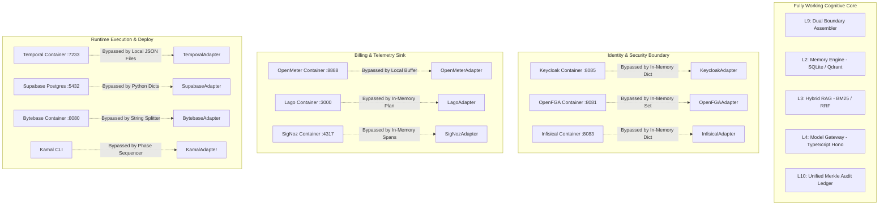

# Central Intelligence Platform Audit — 04. Integration Gap Analysis

**Baseline:** Commit `138b95b` on branch `main`  
**CI Baseline:** GitHub Actions Run `43480953326`  
**Scope:** End-to-end user journeys, interface mismatches, failure recovery, tenant isolation, model provider independence, and cross-layer disconnections.

---

## 1. End-to-End User Journey Tracing

This audit traced 5 core end-to-end user journeys through the 19 layers to verify whether data flow is real or simulated.

### Journey 1: Chat Turn with RAG & Fact Memory Recall
- **Intended Path:** `L18 (LibreChat) -> L12 (Keycloak) -> L9 (Context Assembler) -> L10 (PII/Audit) -> L8 (Orchestration) -> L4 (Model Gateway) -> L3 (Hybrid RAG) -> L2 (Memory Engine) -> L6 (Generative UI) -> L13 (OpenMeter) -> L14 (SigNoz)`
- **Trace Analysis:**
  1. `LibreChatAdapter.create_conversation()` and `send_message()` are invoked in Python memory (`surface/interaction/web/librechat_adapter.py#L72`). No HTTP connection to the LibreChat container (`:3080`).
  2. `KeycloakAdapter` validates passwords using local SHA-256 in RAM; no OIDC token request to Keycloak container (`:8085`).
  3. `DualBoundaryAssembler` (`control/context/trust/boundary_assembler.py#L33`) real and active: escapes closing XML tags and tags content as `<untrusted_content>`.
  4. `LocalHybridSearchEngine` (`cognitive/knowledge/search/engines/local_hybrid.py`) executes real BM25 + dense vector ranking.
  5. `MemoryEngine` (`cognitive/memory/engine.py#L164`) successfully writes facts to SQLite and recalls previous context.
  6. `OpenMeterAdapter` (`control/billing/metering/openmeter_adapter.py#L46`) appends token event to local Python list; if remote dispatch fails, it catches exception and logs debug.
  7. `SigNozAdapter` (`control/observability/signoz/signoz_adapter.py#L52`) appends span to in-memory list; zero OTLP packets transmitted.
- **Verdict:** **PARTIALLY REAL / DISCONNECTED SURFACES.** The cognitive core (L9 -> L3 -> L2 -> L4) functions, but the interaction surface (L18), identity gate (L12), billing dispatch (L13), and telemetry sink (L14) operate in simulated RAM mode.

---

### Journey 2: Autonomous Agent Task with Tool Sandbox Execution
- **Intended Path:** `L18 (Surface) -> L8 (Planner) -> L5 (Agent Runner) -> L5 (E2B Cloud MicroVM) -> L10 (Merkle Audit) -> L19 (Huly PM)`
- **Trace Analysis:**
  1. `MultiStepPlanner` decomposes task into DAG of nodes.
  2. `E2BSandboxAdapter` (`cognitive/action/agent/sandbox/e2b_adapter.py#L38`) checks for `e2b` package. Because `e2b` is not installed, it falls back to lines 65–71:
     ```python
     return {
         "exit_code": 0,
         "stdout": f"[E2B Simulated MicroVM ({config.template})]: executed `{command}` successfully",
         "stderr": "",
         "execution_time_ms": duration_ms,
         "provider": "e2b-simulated",
     }
     ```
  3. The agent runner receives exit code 0 and synthetic string without running any shell command or Python code.
  4. `UnifiedAuditLedger` (`control/safety/audit/ledger.py#L273`) records event into SQLite with genuine SHA-256 Merkle root computation.
  5. `HulyAdapter` creates task, but in tests `httpx.post` is mocked (`tests/integration/test_e2e_full_flow.py#L298`).
- **Verdict:** **SIMULATED EXECUTION.** The agent workflow executes logically, but no real container code execution occurs.

---

### Journey 3: Real-Time Voice Duplex Conversation
- **Intended Path:** `L1 (LiveKit WebRTC) -> L1 (Handy Whisper STT) -> L9 (Context) -> L4 (Model Gateway) -> L6/L1 (TTS Synthesis) -> L1 (WebRTC Stream)`
- **Trace Analysis:**
  1. `LiveKitAdapter.create_token()` generates a real JWT token using `livekit.api.AccessToken`.
  2. `LiveKitAdapter.stream_audio_chunk()` (`cognitive/perception/audio/livekit_adapter.py#L180`) appends the audio chunk to a local Python list `session._stream_buffer`. No WebRTC peer connection or UDP RTP packets are transmitted.
  3. `HandyAdapter` requires `faster-whisper`. Because it is not installed, it fails closed in live mode or extracts text from test headers in test mode.
- **Verdict:** **DISCONNECTED TRANSPORT.** Token generation is real, but audio data transport is an in-memory buffer.

---

### Journey 4: Durable Workflow Crash Survival & Replay
- **Intended Path:** `L8 (DAG Runner) -> Temporal Client -> Temporal Server (:7233) -> Worker -> Crash -> Temporal Server Replay`
- **Trace Analysis:**
  1. `TemporalWorkflowAdapter` (`control/orchestration/workflow_builder/runtime/temporal_adapter.py#L78`) writes checkpoints to `./.temporal_checkpoints/<workflow_id>.json` on local disk.
  2. `temporalio.client.Client` is imported but never connected to `localhost:7233`.
  3. In `tests/integration/test_e2e_full_flow.py` Task 11.3, crash recovery is simulated by raising `ProcessLookupError`, catching it, and calling `execute_workflow(..., resume=True)`, which reads the local JSON file.
- **Verdict:** **LOCAL FILE SIMULATION.** Durability is tied to the local filesystem; the live Temporal server is bypassed.

---

### Journey 5: Billing Lifecycle, Quota Exhaustion & Payment
- **Intended Path:** `L4 (Model Gateway) -> L13 (OpenMeter Token Event) -> L13 (Lago Quota Check) -> L13 (Hyperswitch Payment)`
- **Trace Analysis:**
  1. Token consumption generates CloudEvents 1.0 JSON payloads.
  2. `LagoAdapter` checks monthly token quotas in memory (`lago_adapter.py#L169`). If quota is exceeded and overage is allowed, it attempts credit deduction.
  3. `HyperswitchAdapter` attempts HTTP payment creation with 100ms timeout (`hyperswitch_adapter.py#L140`). When connection fails, `except Exception: pass` silently swallows the failure and marks the transaction as succeeded in memory.
- **Verdict:** **UNENFORCED FINANCIAL CONTROLS.** Exceptions in live payment processing are swallowed, and Lago subscription state is not synchronized with the Lago database.

---

## 2. Disconnection Zones



---

## 3. Interface Mismatches & Protocol Discrepancies

| Subsystem | Documented Spec | Actual Implementation | Impact |
| :--- | :--- | :--- | :--- |
| **Context Dual Boundary** | `<untrusted_user_input hash="...">` (`docs/SECURITY_REVIEW.md#L73`) | `<untrusted_content source="..." trust="...">` (`control/context/trust/untrusted_sandbox.py#L25`) | Downstream parsers expecting `<untrusted_user_input>` will fail to match tags. |
| **Production Environment Flag** | `ENV=production` (`docs/DEPLOYMENT.md#L33`, `SECURITY_REVIEW.md#L51`) | `ENVIRONMENT=production` (`control/safety/production_guard.py#L30-L32`) | Operators setting `ENV=production` unknowingly leave production guard disabled. |
| **PostgreSQL Driver** | `psycopg2` (`cognitive/memory/tiers/facts/postgres_adapter.py#L27`) | `pg8000` installed in `pyproject.toml#L36` | `PostgreSQLFactStore` crashes with `ModuleNotFoundError` despite PostgreSQL client installed. |
| **Supabase Data Model** | Parameterized queries with `%s` (`docs/SECURITY_REVIEW.md#L81`) | In-memory Python dictionaries with `math.sqrt` cosine similarity (`platform_infra/data/supabase/supabase_adapter.py#L57`) | No relational persistence; data lost on process exit. |
| **Temporal Client** | Temporal Server gRPC protocol (`docs/architecture.md#L88`) | Local JSON file writes to `./.temporal_checkpoints/` (`control/orchestration/workflow_builder/runtime/temporal_adapter.py#L78`) | No distributed scheduling or cluster fault-tolerance. |

---

## 4. Fallback, Retry, Timeout, and Failure Recovery Audit

| Layer | Component | Failure Scenario | Implemented Behavior | Flaw / Risk |
| :--- | :--- | :--- | :--- | :--- |
| **L4** | Model Gateway | Provider 429 / 500 error | Circuit breaker triggers cooldown; falls back to secondary provider via OmniRouter. | **Robust.** Fully working TypeScript implementation. |
| **L13** | Hyperswitch | Payment API unreachable | Catches all exceptions with `pass`; returns success status. | **CRITICAL DEFECT.** Uncharged payments treated as successful. |
| **L13** | OpenMeter | Metering daemon down | Catches exception; sets `remote_dispatched = False`; buffers locally in memory. | **Data Loss Risk.** Buffer lost if process restarts before recovery. |
| **L1** | Crawl4AI | Playwright crawler fails | Falls back to HTTP `httpx` + BeautifulSoup parser. | **Good Graceful Degradation.** Non-headless HTML parsing succeeds. |
| **L1** | PaddleOCR | OCR engine uninstalled | Falls back to static string without calling `fail_closed_in_production()`. | **Silent Insecure Fallback.** Violates Crown Jewel rule. |
| **L15** | Dragonfly | Redis server down | Logs warning; falls back to internal in-memory dictionary. Calls `fail_closed_in_production()` in live mode. | **Robust.** Correctly differentiates test vs live mode. |

---

## 5. Model Provider Independence & BYOK

- **Model Provider Independence:** **HIGH.** The Layer 4 Model Gateway (`cognitive/reasoning/`) cleanly abstracts OpenAI, Anthropic, Google Gemini, AWS Bedrock, and local Ollama endpoints using standard Web Streams and Zod validation schemas. Switching active models requires zero codebase changes.
- **BYOK (Bring Your Own Key):** **MEDIUM.** The architecture specifies BYOK via `cognitive/reasoning/src/security/byok.ts` and `control/identity/secrets/infisical_adapter.py`. However, because `InfisicalAdapter` currently retains secrets in RAM dictionaries, BYOK keys are lost when the container restarts.
- **Tenant Isolation:** **LOW (Operational) / HIGH (Logical).** Logically, all data structures and ReBAC schemas include `tenant_id` scoping. Operationally, because storage layers (`SupabaseAdapter`, `OpenFGAAdapter`, `KeycloakAdapter`) operate in shared Python process memory, tenant isolation relies entirely on in-memory filter loops (`rec.tenant_id == tenant_id`) rather than database-level Row Level Security (RLS) or separate database schemas.
