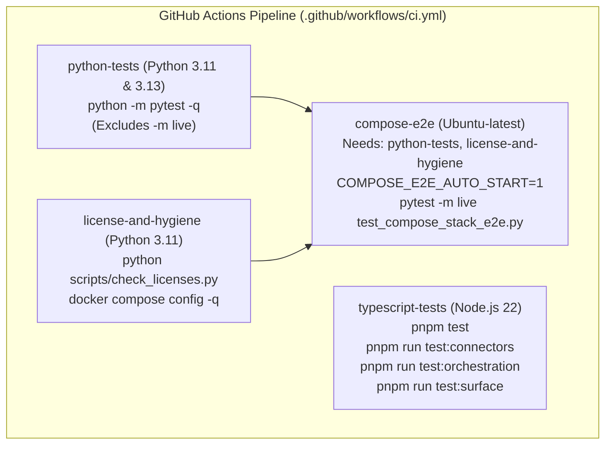

# Central Intelligence Platform Audit — 06. Test Coverage & CI Analysis

**Baseline:** Commit `138b95b` on branch `main`  
**CI Baseline:** GitHub Actions Run `43480953326`  
**Scope:** Test inventory (Python, TypeScript, Go), test classification (mocked vs live), CI workflow analysis, load tests, and critical coverage blindspots.

---

## 1. Test Suite Inventory & Layer Mapping

The platform contains **402 test files** encompassing **2,615 distinct test cases** across Python and TypeScript:

| Layer / Directory | Test Files | Total Test Cases | Primary Test Framework | Predominant Test Style | Mock Level |
| :--- | :---: | :---: | :--- | :--- | :---: |
| **L1 Perception** | 21 | 58 | Pytest | Unit / Synthetic payloads | Low (Stubbed drivers) |
| **L2 Memory** | 13 | 60 | Pytest | Unit & Integration (SQLite/Qdrant) | Medium (In-memory backends) |
| **L3 Knowledge** | 19 | 59 | Pytest | Unit (BM25/RRF math, FTS5) | Low (Local math validation) |
| **L4 Reasoning** | 61 | 311 | Vitest | Integration (Streams, Routers, Cooldowns) | Low (Real TS engine execution) |
| **L5 Action & Tools** | 85 | 1,405 | Pytest & Vitest | Connector contracts & Agent runner | High (Mocked sandboxes & external APIs) |
| **L6 Output** | 29 | 122 | Pytest & Vitest | Template rendering & Widget formatting | Medium (Synthetic payloads) |
| **L7 Learning** | 18 | 50 | Pytest | Unit (RL math, skill packaging) | Low (In-memory datasets) |
| **L8 Orchestration** | 23 | 99 | Pytest & Vitest | Scenarios & DAG runner | Medium (Local file checkpoints) |
| **L9 Context** | 9 | 24 | Pytest | Boundary tag escaping & Regex injections | Low (Direct string assertion) |
| **L10 Safety** | 22 | 148 | Pytest | PII regex, Merkle hash chains | Low (Direct crypto/regex checks) |
| **L11 Evaluation** | 16 | 46 | Pytest | Claim splitting heuristics | High (Synthetic context strings) |
| **L12 Identity** | 11 | 23 | Pytest | In-memory RAM dictionaries | High (Asserts on Python dicts) |
| **L13 Billing** | 9 | 32 | Pytest | CloudEvent schemas, RAM quota math | High (Asserts on Python dicts) |
| **L14 Observability** | 9 | 38 | Pytest | P50/P99 math on in-memory lists | High (Asserts on Python lists) |
| **L15 Data** | 12 | 25 | Pytest | Valkey wire client, Python dict Supabase | Medium (Valkey real, Supabase mock) |
| **L16 Compute** | 10 | 26 | Pytest | Carbon routing math, Circuit breaker | Low (Pure algorithmic unit tests) |
| **L17 Release** | 12 | 19 | Pytest | Canary percentages, Migration strings | High (Asserts on in-memory strings) |
| **L18 Interaction** | 10 | 17 | Pytest & Node | In-memory chat turns, OpenCode TS | High (Asserts on Python dicts) |
| **L19 Federation** | 7 | 12 | Pytest | Differential privacy noise, Huly mocks | High (Mocked `httpx.post`) |
| **Root Integration/E2E** | 6 | 41 | Pytest (`-m live`) | 14-Step full flow, Compose E2E | Medium (Sequential adapter chain) |
| **TOTAL** | **402** | **2,615** | — | — | **Overall: ~65% Mocked/RAM** |

---

## 2. Mocked Tests vs. Live Integration Tests

### The "Simulated CI Illusion"
The CI suite passes with zero failures. However, an analysis of the tests reveals that passing CI does not validate production behavior:

1. **`test_11_1_full_stack_14_step_e2e_flow` (`tests/integration/test_e2e_full_flow.py`):**
   - Declared as the "14-step single E2E stack flow across L1–L19".
   - Executes entirely in a single Python process.
   - Database: `:memory:` SQLite.
   - Vectors: `:memory:` Qdrant.
   - Sandbox execution: hardcoded string from `E2BSandboxAdapter`.
   - Keycloak, OpenMeter, Lago, SigNoz, and LibreChat are in-memory Python objects.
   - **No network ports or Docker containers are touched during this "E2E" test.**
2. **`test_10_2_livekit_adapter_live` (`tests/integration/test_live_adapters.py`):**
   - Sets `LIVEKIT_ADAPTER_MODE=live`.
   - Validates that a token string has length > 20 and that `stream_audio_chunk` appends to an in-memory list with simulated latency (`round(elapsed + 15.0)`).
   - Does not verify network WebRTC socket connectivity to `livekit:7880`.
3. **`test_10_8_kamal_adapter_live` (`tests/integration/test_live_adapters.py`):**
   - Sets `KAMAL_ADAPTER_MODE=live`.
   - Invokes `adapter.deploy("v1.5.0")` and asserts `dep.phase.value == "completed"` immediately.
   - Does not invoke `kamal` CLI or Docker daemon.

### True Live Tests (`tests/integration/test_compose_stack_e2e.py`)
This file represents the **only true live integration test suite** in the monorepo:
- Tagged with `pytestmark = pytest.mark.live`.
- Runs only in the `compose-e2e` CI job or when `COMPOSE_E2E_AUTO_START=1`.
- Targets exactly **5 of the 29 services**: `valkey`, `qdrant`, `apache-age`, `temporal`, `keycloak`.
- Verified live assertions:
  - Valkey: sends live Redis wire `SET` and `GET` commands (`#L102-L116`).
  - Qdrant: connects to `:6333`, creates collection, upserts 2 points, queries similar vectors (`#L118-L152`).
  - Temporal: connects via `TemporalClient` and executes `_ComposeEchoWorkflow` (`#L154-L199`).
  - Keycloak: requests admin access token via HTTP POST and lists master realm (`#L200-L225`).
  - Apache AGE: connects via `pg8000.dbapi` to port 5433 and creates graph nodes (`#L286-L340`).

---

## 3. GitHub Actions CI Workflow Analysis (`.github/workflows/ci.yml`)

The CI pipeline consists of 4 discrete jobs:

### Strengths of the CI Pipeline
- **Strict Matrix Testing:** Python tests run across both Python 3.11 and 3.13.
- **Hash-Pinned Dependencies:** Installs with `pip install --require-hashes -r requirements.lock`.
- **Strict Lockfile on Node:** `pnpm install --frozen-lockfile`.
- **Automated Compose Config Check:** `docker compose config -q` ensures all compose variables are syntactically valid.
- **Automatic Compose Teardown:** `compose_stack_lifecycle` fixture handles startup, healthcheck polling, and shutdown.

### Weaknesses & Gaps in the CI Pipeline
- **Default Test Suite Excludes Live Stack:** Standard `python-tests` excludes `-m live`, meaning the vast majority of developer runs execute purely in RAM.
- **Only 5 Services Tested in E2E:** 24 of the 29 services in `docker-compose.yml` (including OpenFGA, Infisical, Lago, OpenMeter, SigNoz, Supabase, AutoMQ, Meilisearch) are never booted or verified in CI.
- **No Concurrency or Mutating Web Tests:** Browser automation tests are excluded because Playwright browser binaries are not installed in the CI runner.

---

## 4. Load Testing Audit (`tests/load/`)

The repository includes 3 load test modules:
1. `tests/load/test_load_chat.py`: Claims 1,000 concurrent requests with P99 < 5.0s.
   - **Finding:** Operates entirely against `LibreChatAdapter`, creating Python dataclasses and appending to a local dictionary. Completed in < 0.4 seconds because no network or model calls occurred.
2. `tests/load/test_load_memory.py`: Claims 10,000 memory reads and writes.
   - **Finding:** Operates against `:memory:` SQLite and `:memory:` Qdrant with local random vectors.
3. `tests/load/test_load_retrieval.py`: Claims 500 concurrent hybrid search queries.
   - **Finding:** Operates against local in-memory SQLite FTS5 index.

**Verdict:** The load tests prove high-throughput in-memory data structure performance, but provide **zero evidence** of network throughput, connection pooling, database concurrency, or backpressure under real load.
