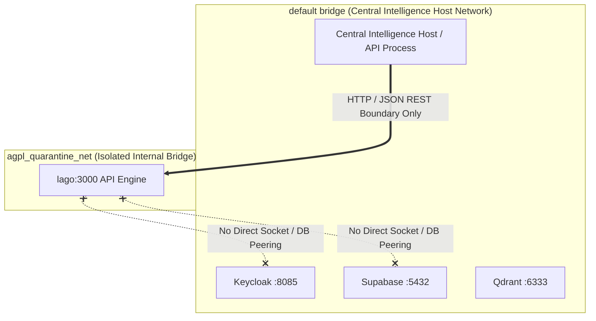

# Central Intelligence Platform Audit — 07. Deployment & Operations

**Baseline:** Commit `138b95b` on branch `main`  
**CI Baseline:** GitHub Actions Run `43480953326`  
**Scope:** Docker Compose stack (29 services), AGPL network quarantine, deployment lifecycle (Kamal / Bytebase), hardware specifications, and disaster recovery runbooks.

---

## 1. Docker Compose Service Topology & Port Inventory

The platform declares 29 services in `docker-compose.yml`:

| Service Name | Pinned Image | Host Port | Network | Volume Mount | License | Profile Guard |
| :--- | :--- | :---: | :--- | :--- | :--- | :--- |
| `qdrant` | `qdrant/qdrant:v1.20.0` | 6333 | default | `qdrant_data:/qdrant/storage` | Apache-2.0 | (Default) |
| `ollama` | `ollama/ollama:0.40.16` | 11434 | default | `ollama_models:/root/.ollama` | MIT | (Default) |
| `meilisearch` | `getmeili/meilisearch:v1.7.3` | 7700 | default | `meili_data:/meili_data` | MIT | (Default) |
| `valkey` | `valkey/valkey:8.0.2-alpine` | 6379 | default | `valkey_data:/data` | BSD-3-Clause | (Default) |
| `chroma` | `chromadb/chroma:0.4.22` | 8000 | default | `chroma_data:/chroma/chroma` | Apache-2.0 | (Default) |
| `temporal` | `temporalio/temporal:1.10.0` | 7233, 8088 | default | `temporal_data:/etc/temporal` | MIT | (Default) |
| `otel-collector` | `otel/opentelemetry-collector:0.120.0` | 4317, 4318 | default | — | Apache-2.0 | (Default) |
| `keycloak` | `quay.io/keycloak/keycloak:26.8.2` | 8085 | default | `keycloak_data:/opt/keycloak/data` | Apache-2.0 | (Default) |
| `openfga` | `openfga/openfga:v1.22.1` | 8081, 8082 | default | `openfga_data:/data` | Apache-2.0 | (Default) |
| `infisical` | `infisical/infisical:v0.167.8` | 8083 | default | `infisical_data:/data` | MIT | (Default) |
| `hyperswitch` | `juspaydotin/hyperswitch-router:v1.129.0-standalone` | 8080 | default | — | Apache-2.0 | (Default) |
| `livekit` | `livekit/livekit-server:v1.13.11` | 7880 | default | — | Apache-2.0 | (Default) |
| `supabase-db` | `supabase/postgres:15.1.1.78` | 5432 | default | `supabase_data:/var/lib/postgresql/data` | Apache-2.0 / PG | (Default) |
| `apache-age` | `apache/age:release_PG16_1.6.0` | 5433 | default | `age_data:/var/lib/postgresql/data` | Apache-2.0 | (Default) |
| `huly` | `hardcoreeng/front:v0.7.432` | 80 | default | `huly_data:/data` | EPL-2.0 | (Default) |
| `kafka` | `apache/kafka:3.8.0` | 9092 | default | `kafka_data:/tmp/kraft-combined-logs` | Apache-2.0 | (Default) |
| `svix` | `svix/svix-server:v1.57.0` | 8071 | default | `svix_data:/data` | MIT | (Default) |
| `openmeter` | `openmeter/openmeter:v1.0.0` | 8888 | default | — | Apache-2.0 | (Default) |
| `signoz` | `signoz/signoz:v0.66.0` | 3301 | default | `signoz_data:/var/lib/signoz` | MIT / Apache-2.0 | (Default) |
| `uptime-kuma` | `louislam/uptime-kuma:1.23.13` | 3001 | default | `uptime_kuma_data:/app/data` | MIT | (Default) |
| `posthog` | `posthog/posthog:v1.50.0` | 8090 | default | `posthog_data:/data` | MIT | (Default) |
| `bytebase` | `bytebase/bytebase:3.2.0` | 8084 | default | `bytebase_data:/var/opt/bytebase` | Apache-2.0 | (Default) |
| `librechat` | `ghcr.io/danny-avila/librechat:v0.7.7` | 3080 | default | `librechat_data:/app/data` | MIT | (Default) |
| `memgraph` | `memgraph/memgraph-platform:...` | 7687 | default | `memgraph_data:/var/lib/memgraph` | BSL-1.1 | `self-hosted-non-osi` |
| `falkordb` | `falkordb/falkordb:v4.22.3` | 6380 | default | `falkordb_data:/data` | SSPL-v1 | `self-hosted-non-osi` |
| `nango` | `nangohq/nango-server:hosted-0.72.4` | 3003 | default | `nango_data:/data` | Elastic-2.0 | `self-hosted-non-osi` |
| `phoenix` | `arizephoenix/phoenix:version-21.0.0` | 6006 | default | `phoenix_data:/data` | Elastic-2.0 | `self-hosted-non-osi` |
| `dragonfly` | `docker.dragonflydb.io/...:v1.26.1` | 6381 | default | `dragonfly_data:/data` | BSL-1.1 | `self-hosted-non-osi` |
| `lago` | `getlago/api:v1.16.0` | 3000 | `agpl_quarantine_net` | — | AGPL-3.0 | `agpl-quarantine` |

---

## 2. AGPL Network Quarantine Architecture



### Quarantine Policy Enforcement
- `lago` is explicitly bound to `networks: [agpl_quarantine_net]`.
- Central Intelligence interacts strictly across JSON-over-HTTP REST endpoints.
- `scripts/check_licenses.py#L76` verifies that zero `import lago` statements exist in the Python codebase.

---

## 3. Deployment Lifecycle Audit

### Kamal Rolling Zero-Downtime Releases (`docs/DEPLOYMENT.md#L117-129`)
- **Documented Procedure:**
  ```bash
  kamal build
  kamal deploy
  kamal rollback
  ```
- **Code Reality:** `platform_infra/release/ci/kamal_adapter.py` is a Python class that simulates phase transitions (`INIT -> ACQUIRE_LOCK -> PUSH_IMAGE -> BOOT_CONTAINER -> HEALTHCHECK_PROBE -> PROXY_SWAP -> COMPLETED`) by appending strings to a list in RAM. It does not invoke Kamal or communicate with the Docker daemon.
- **Operational Assessment:** No real Kamal deployment automation exists. Deployments must currently be managed manually via Docker Compose or Kubernetes manifests.

### Bytebase Database Schema Migrations (`docs/DEPLOYMENT.md#L90-101`)
- **Documented Procedure:** Automated schema discovery and migrations managed through `bytebase_adapter.py`.
- **Code Reality:** `platform_infra/release/db/bytebase_adapter.py#L128-L137` splits SQL statements by semicolon in Python memory. It does not connect to PostgreSQL or execute DDL.
- **Operational Assessment:** Schema migrations must currently be applied manually or through raw psql scripts.

---

## 4. Hardware Sizing & Resource Requirements

| Environment | Minimum (Documented) | Recommended (Documented) | Audit Operational Assessment |
| :--- | :--- | :--- | :--- |
| **CPU** | 8 Cores | 16+ Cores | Running all 29 containers simultaneously requires at least 8 real CPU cores to prevent scheduling starvation. |
| **RAM** | 16 GB | 32+ GB | Baseline container memory for all 29 services is ~12.5 GB. 16 GB leaves narrow margin; **32 GB is practically required**. |
| **Storage** | 50 GB NVMe | 100+ GB NVMe | Docker image pulls for 29 pinned containers total ~28 GB disk space. |
| **GPU** | Optional | NVIDIA CUDA 12.0+ (16GB VRAM) | Required only if running local Ollama inference (`llama3.2`) or local cross-encoders. |

---

## 5. Operational Runbooks & Disaster Recovery

### Scenario 1: Python Process / Pod Crash
- **Impact: CATASTROPHIC DATA LOSS.**
  - All users registered via `KeycloakAdapter` in RAM are lost.
  - All ReBAC tuples created via `OpenFGAAdapter` in RAM are lost.
  - All secrets vaulted via `InfisicalAdapter` in RAM are wiped.
  - All active billing balances in `LagoAdapter` are reset.
- **Immediate Recovery Action:**
  - Until persistent database wiring is completed (Roadmap Milestones 1 & 2), the Central Intelligence process must **never be restarted** without re-seeding bootstrap users, keys, and permissions.

### Scenario 2: Docker Container Failure (e.g. Qdrant or Valkey Crash)
- **Impact: MINIMAL.**
  - `docker-compose.yml` mounts named volumes (`qdrant_data`, `valkey_data`, `supabase_data`). Restarting the container preserves data.
- **Recovery Action:**
  ```bash
  docker compose restart qdrant valkey
  ```

### Scenario 3: Secret Rotation Under Live Load
- **Procedure:**
  - Call `InfisicalAdapter.rotate_secret(key, new_value, grace_period_seconds=3600)`.
  - Prior secret versions remain valid for 1 hour (`expires_at`), allowing downstream workers to drain gracefully without connection drop.
