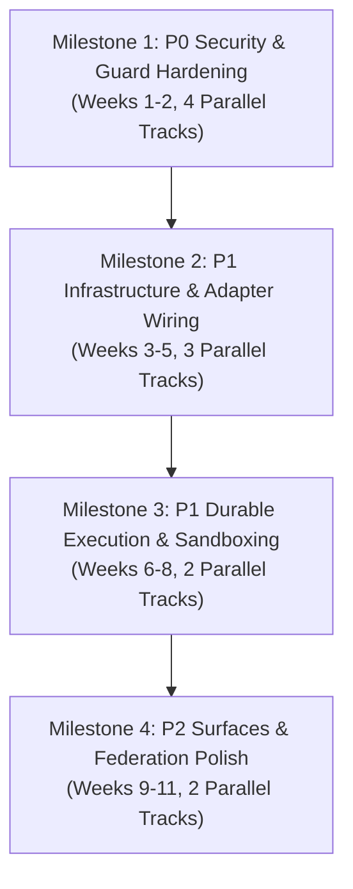

# Central Intelligence Platform Audit — 08. Prioritized Completion Roadmap

**Baseline:** Commit `138b95b` on branch `main`  
**Guiding Principle:** Working, secure, and genuinely integrated platform over superficial feature counts. Zero mandatory paid cloud costs.

---

## 1. Roadmap Overview & Milestone Structure

The remediation and stabilization roadmap is structured into 4 sequential milestones:
- **Milestone 1: Security & Production Guard Hardening (P0 Critical)**
- **Milestone 2: Real Adapter & Infrastructure Wiring (P1 High)**
- **Milestone 3: Execution, Sandboxing & Storage Hardening (P1 High)**
- **Milestone 4: Surface Integration & Multimodal Polish (P2/P3 Medium & Low)**



---

## 2. Milestone 1: P0 Security & Production Guard Hardening

*Target Duration: 2–3 Weeks | Effort: 60–90 Engineering Hours (±20% uncertainty) | Priority: P0 Critical*

### Tasks & Specifications

#### Task 1.1: Resolve Production Guard Environment Variable Defect [Parallel Track A]
- **Affected Layers:** Layer 10 (Safety), Layer 12 (Identity)
- **Files:** `control/safety/production_guard.py`
- **Implementation Task:** Update `is_production()` to check both `ENVIRONMENT` and `ENV`:
  ```python
  def is_production() -> bool:
      env = (os.getenv("ENVIRONMENT") or os.getenv("ENV") or "").strip().lower()
      return env in ("production", "prod")
  ```
- **Acceptance Criteria:** `is_production()` returns `True` when either `ENV=production` or `ENVIRONMENT=production` is set; raises `ProductionSafetyError` if any simulated adapter is loaded.

#### Task 1.2: Enforce `fail_closed_in_production()` Across All 19 Non-Compliant Adapters [Parallel Track B]
- **Affected Layers:** L1, L10, L11, L12, L13, L14, L15, L17, L18
- **Files:**
  - `cognitive/perception/document/crawl4ai_adapter.py`
  - `cognitive/perception/document/unstructured_adapter.py`
  - `cognitive/perception/vision/paddleocr_adapter.py`
  - `control/billing/engine/lago_adapter.py`
  - `control/billing/metering/openmeter_adapter.py`
  - `control/billing/payments/hyperswitch_adapter.py`
  - `control/evaluation/langwatch/langwatch_adapter.py`
  - `control/evaluation/phoenix/phoenix_adapter.py`
  - `control/identity/openfga_adapter.py`
  - `control/identity/secrets/infisical_adapter.py`
  - `control/observability/posthog/posthog_adapter.py`
  - `control/observability/signoz/signoz_adapter.py`
  - `control/observability/uptime/uptime_kuma_adapter.py`
  - `control/safety/consent/c15t_adapter.py`
  - `platform_infra/data/supabase/supabase_adapter.py`
  - `platform_infra/release/ci/kamal_adapter.py`
  - `platform_infra/release/db/bytebase_adapter.py`
  - `surface/interaction/desktop/jan_adapter.py`
  - `surface/interaction/web/librechat_adapter.py`
- **Implementation Task:** Add explicit `fail_closed_in_production()` calls in `__init__()` and execution methods when running in live/production mode without valid network connectivity or credentials.
- **Acceptance Criteria:** Codebase AST scanner verifies 0 dead imports of `fail_closed_in_production`; running adapters without live services in production mode raises fatal `ProductionSafetyError`.

#### Task 1.3: Eliminate Hyperswitch Silent Exception Swallowing [Parallel Track C]
- **Affected Layers:** Layer 13 (Billing)
- **Files:** `control/billing/payments/hyperswitch_adapter.py#L157-L159`
- **Implementation Task:** Remove `except Exception: pass`. Catch network/HTTP errors explicitly, log at ERROR level, and raise `PaymentProcessingError` with `fail_closed_in_production("hyperswitch", ...)`.
- **Acceptance Criteria:** Unreachable Hyperswitch server causes payment calls to fail and raise errors rather than returning a fraudulent successful status.

#### Task 1.4: Resolve PostgreSQL Fact Store Driver Dependency [Parallel Track D]
- **Affected Layers:** Layer 2 (Memory)
- **Files:** `cognitive/memory/tiers/facts/postgres_adapter.py#L27`
- **Implementation Task:** Replace `psycopg2` with `pg8000` (which is already pinned in `requirements.lock` and used by `ApacheAGEAdapter`), or add `psycopg2-binary>=2.9.9` to `pyproject.toml`.
- **Acceptance Criteria:** `PostgreSQLFactStore` can connect to PostgreSQL without `ModuleNotFoundError`.

---

## 3. Milestone 2: P1 Real Infrastructure & Adapter Wiring

*Target Duration: 3–4 Weeks | Effort: 100–140 Engineering Hours (±25% uncertainty) | Priority: P1 High*

### Tasks & Specifications

#### Task 2.1: Wire OpenFGA ReBAC Adapter to Live OpenFGA Service [Parallel Track A]
- **Affected Layers:** Layer 12 (Identity), Layer 2 (Memory), Layer 3 (Knowledge)
- **Files:** `control/identity/openfga_adapter.py`
- **Implementation Task:** Replace `self._tuples = set()` with `openfga-sdk` or direct HTTP calls to `http://openfga:8081/stores/{store_id}/check` and `write`. Retain in-memory set as explicit fallback only when `CI_TEST_MODE=1`.
- **Acceptance Criteria:** Relationship tuples written to OpenFGA persist across Python process restarts; verified against live OpenFGA container in `tests/integration/test_compose_stack_e2e.py`.

#### Task 2.2: Wire Infisical Adapter to Live Infisical KMS Vault [Parallel Track B]
- **Affected Layers:** Layer 12 (Identity), Layer 4 (Reasoning)
- **Files:** `control/identity/secrets/infisical_adapter.py`
- **Implementation Task:** Implement REST API client querying `http://infisical:8083/api/v1/secrets`. Store master encryption keys in environment variables; encrypt in-flight payloads.
- **Acceptance Criteria:** Secrets stored via `InfisicalAdapter` survive Python restart; retrieved from Infisical service.

#### Task 2.3: Wire Billing Adapters (OpenMeter & Lago) to Live Endpoints [Parallel Track C]
- **Affected Layers:** Layer 13 (Billing)
- **Files:** `control/billing/metering/openmeter_adapter.py`, `control/billing/engine/lago_adapter.py`
- **Implementation Task:**
  - `OpenMeterAdapter`: wire `query_usage()` to issue HTTP GET requests to `http://openmeter:8888/api/v1/meters/{id}/query`.
  - `LagoAdapter`: implement authenticated HTTP client using `httpx` issuing requests to `http://lago:3000/api/v1/customers` and `subscriptions`.
- **Acceptance Criteria:** Token consumption events appear in OpenMeter; customer plan quotas are verified against Lago database.

#### Task 2.4: Wire SigNoz Adapter to OpenTelemetry OTLP Collector [Parallel Track C]
- **Affected Layers:** Layer 14 (Observability)
- **Files:** `control/observability/signoz/signoz_adapter.py`
- **Implementation Task:** Configure `opentelemetry.exporter.otlp.proto.grpc.trace_exporter` to export spans to `http://signoz:4317` (or `otel-collector:4317`).
- **Acceptance Criteria:** Spans and metrics generated by Central Intelligence appear in SigNoz web dashboard.

---

## 4. Milestone 3: P1 Durable Execution & Sandboxing

*Target Duration: 3–4 Weeks | Effort: 90–130 Engineering Hours (±20% uncertainty) | Priority: P1 High*

### Tasks & Specifications

#### Task 3.1: Wire Temporal Workflow Adapter to Live Temporal Daemon [Parallel Track A]
- **Affected Layers:** Layer 8 (Orchestration)
- **Files:** `control/orchestration/workflow_builder/runtime/temporal_adapter.py`
- **Implementation Task:** Initialize asynchronous `temporalio.client.Client.connect(self.target_host)` and execute workflows using real Temporal workflow definitions rather than writing local JSON files to `./.temporal_checkpoints/`.
- **Acceptance Criteria:** Workflows register on Temporal Server (`localhost:7233`); workflow execution history is inspectable in Temporal Web UI (`:8088`).

#### Task 3.2: Wire Supabase Adapter to Real PostgreSQL & pgvector [Parallel Track B]
- **Affected Layers:** Layer 15 (Data)
- **Files:** `platform_infra/data/supabase/supabase_adapter.py`
- **Implementation Task:** Replace in-memory dictionaries `self.tables` and `self.vector_collections` with real SQL queries using `asyncpg` or `pg8000`. Use pgvector `<=>` operator for cosine similarity search.
- **Acceptance Criteria:** Tables and embeddings persist in PostgreSQL; survive application restart.

#### Task 3.3: Implement Local Container Sandbox for Tool Execution [Parallel Track B]
- **Affected Layers:** Layer 5 (Action)
- **Files:** `cognitive/action/agent/sandbox/local_docker_adapter.py`, `e2b_adapter.py`
- **Implementation Task:** Implement a rootless Podman / Docker container runner executing tools with CPU, memory, and network constraints, eliminating hardcoded mock string returns.
- **Acceptance Criteria:** `E2BSandboxAdapter` or `LocalDockerAdapter` executes actual commands (e.g. `Fibonacci(10)`) and returns computed stdout.

---

## 5. Milestone 4: P2/P3 Surfaces & Federation Polish

*Target Duration: 2–3 Weeks | Effort: 60–80 Engineering Hours (±20% uncertainty) | Priority: P2/P3 Medium & Low*

### Tasks & Specifications

#### Task 4.1: LibreChat Web Chat Reverse Proxy Bridge (P2) [Parallel Track A]
- **Affected Layers:** Layer 18 (Interaction), Layer 4 (Reasoning)
- **Files:** `surface/interaction/web/librechat_adapter.py`
- **Implementation Task:** Configure LibreChat container (`librechat:3080`) custom endpoint configuration (`librechat.yaml`) to point to Layer 4 Model Gateway (`http://reasoning:8787/v1`).
- **Acceptance Criteria:** User typing in LibreChat web UI receives real streaming LLM completions from Central Intelligence.

#### Task 4.2: Replace Kamal and Bytebase Synthetic Models (P2) [Parallel Track B]
- **Affected Layers:** Layer 17 (Release)
- **Files:** `platform_infra/release/ci/kamal_adapter.py`, `platform_infra/release/db/bytebase_adapter.py`
- **Implementation Task:** Replace string-appending state machines with real CLI invocation wrappers (`subprocess.run(["kamal", ...])`) and Bytebase REST API calls.
- **Acceptance Criteria:** Kamal deployments and Bytebase migrations execute real system operations.

#### Task 4.3: Real WebRTC Audio Streaming in LiveKit Adapter (P3) [Parallel Track B]
- **Affected Layers:** Layer 1 (Perception)
- **Files:** `cognitive/perception/audio/livekit_adapter.py`
- **Implementation Task:** Implement real WebRTC data and media streaming using `livekit` Python SDK.
- **Acceptance Criteria:** Audio chunks are transmitted to live LiveKit room.

---

## 6. Work Breakdown & Effort Summary

| Milestone | Priority | Focus | Duration | Estimated Effort | Parallel Tracks | Cost (Zero Paid Mandatory) |
| :--- | :---: | :--- | :---: | :---: | :---: | :---: |
| **Milestone 1** | **P0** | Security & Production Guard Hardening | 2–3 Wks | 60–90 hrs | 4 Tracks | $0 (Local OSS) |
| **Milestone 2** | **P1** | Core Infrastructure & Adapter Wiring | 3–4 Wks | 100–140 hrs | 3 Tracks | $0 (Docker Compose) |
| **Milestone 3** | **P1** | Durable Orchestration & Sandboxing | 3–4 Wks | 90–130 hrs | 2 Tracks | $0 (Local Docker/WASM) |
| **Milestone 4** | **P2/P3** | Surfaces & Federation Polish | 2–3 Wks | 60–80 hrs | 2 Tracks | $0 (Open Source) |
| **TOTAL** | — | **Full Platform Production Hardening** | **10–14 Wks** | **310–440 hrs** | — | **$0.00** |
