# Central Intelligence V1 — Comprehensive Technology Stack, OSS & Custom Architecture Inventory

**Author:** Staff Principal Architect & Systems Reliability Lead  
**Repository:** `Aashish-RC/Central-Intelligence`  
**Target Release:** v1.0.0 Enterprise Production  
**Scope:** Complete inventory of in-house custom architecture, ported open-source repositories, third-party container engines, libraries, and runtime tooling across all 19 layers.

---

## 1. Executive Architecture Overview

Central Intelligence is architectured across **four operational planes** and **nineteen functional layers**, designed under the principle of **capability-first modularity**: *a mandatory capability does not bind the system to a single vendor implementation*.

```mermaid
graph TD
    subgraph Surface ["Surface Plane (L17 - L19)"]
        L18["L18: User Interfaces (LibreChat, OpenCode, Zed)"]
        L17["L17: Integration Connectors (ActivePieces pieces)"]
        L19["L19: Developer Platform (SDKs, REST, CLI)"]
    end

    subgraph Control ["Control Plane (L7 - L13)"]
        L8["L8: Orchestration (Temporal & Rivet DAG Engine)"]
        L12["L12: Identity & Governance (OpenFGA ReBAC & Infisical Vault)"]
        L13["L13: Billing & Metering (Lago Engine & OpenMeter OLAP)"]
        L11["L11: Safety & Guardrails (SecurityGovernor & Merkle Ledger)"]
        L10["L10: Context Engine (Token Budgeter & Compactor)"]
        L7["L7: Metacognition (Evaluation & Confidence)"]
        L9["L9: Continuous Learning (Feedback & Memory Consolidation)"]
    end

    subgraph Cognitive ["Cognitive Plane (L1 - L6)"]
        L4["L4: Reasoning Engine (Multi-Model Router & TieredGate)"]
        L3["L3: Knowledge & Retrieval (Hybrid RRF: Qdrant + AGE + pgvector)"]
        L2["L2: Working Memory (Episodic Context & Semantic Cache)"]
        L5["L5: Action & Execution (Container Sandbox & Curated Registry)"]
        L1["L1: Perception (LiveKit WebRTC Audio/Video)"]
        L6["L6: Output Generation (Multimodal Synthesis & Streaming)"]
    end

    subgraph Infra ["Platform Infrastructure Plane (L14 - L16)"]
        L15["L15: Data & Messaging (Postgres 15, Valkey 8, Kafka 3.9, Svix)"]
        L14["L14: Observability (SigNoz APM, ClickHouse, OTel Collector)"]
        L16["L16: Deployment & Lifecycle (Docker, Kamal, Bytebase DDL)"]
    end

    Surface --> Control
    Control --> Cognitive
    Cognitive --> Infra
```

---

## 2. In-House Custom Architecture & Core Innovations

The following modules represent proprietary/in-house architectural implementations built specifically for Central Intelligence:

| Component / Module | Source Location | Key Capabilities & Technical Innovation |
|---|---|---|
| **SecurityGovernor** | `cognitive/action/sandboxes/governor/security_governor.py` | 12-point runtime security governor enforcing Linux/Windows host isolation, read-only rootfs, zero privilege escalation (`CapEff=0`), cgroup memory/CPU limits, loopback-only network isolation, and blocking 45 adversarial host escape vectors (UNC paths, DOS devices, mshta, certutil, etc.). |
| **TieredActivationGate** | `cognitive/reasoning/src/index.ts` | Multi-tier reasoning synthesizer providing zero-cost local LLM routing and synthetic token evaluation without requiring paid upstream commercial API keys. |
| **Model Hot-Swap Manager** | `platform_infra/compute/lifecycle/hot_swap.py` | Seamless dynamic failover across LLM providers (Anthropic, OpenAI, Google Gemini, local Ollama) with zero request drops during provider rate-limits or outages. |
| **Hybrid RRF Retrieval Engine** | `cognitive/knowledge/retrieval/` | Reciprocal Rank Fusion combining ANN dense vector search (Qdrant/pgvector), knowledge graph traversal (Apache AGE OpenCypher), and full-text keyword indexing (Meilisearch) with cross-tenant isolation. |
| **Cryptographic Merkle Audit Ledger** | `control/safety/audit/ledger.py` | Immutable, tamper-evident Merkle hash chain logging every agent action, tool invocation, credential lease, and security violation with automated sequence verification. |
| **Multi-Database Logical Initializer** | `compose/postgres/init-multi-db.sh` | Consolidates 6 distinct database requirements (`openfga`, `infisical`, `lago`, `openmeter`, `signoz`, `bytebase`) into a single PostgreSQL container with isolated roles and zero cross-tenant leakage. |
| **Deterministic Bootstrap Harness** | `scripts/bootstrap.sh`, `scripts/bootstrap.ps1`, `scripts/generate_env.py` | Cross-platform zero-drift bootstrapping, SHA256 locked dependency verification, and deterministic generation of 2048-bit RSA keys and 256-bit cryptographically secure secrets. |
| **Curated Tool Registry** | `cognitive/action/registry/curated_registry.py` | Tenant-isolated action dispatcher verifying ReBAC permissions before executing tools or shell commands. |

---

## 3. Ported & Clean-Room Open-Source Repositories (OSS)

Central Intelligence incorporates architectural patterns and clean-room implementations from several leading open-source repositories under permissive licenses:

| Upstream Project | Upstream License | Central Intelligence Port / Adaptation | Attribution Location |
|---|:---:|---|---|
| **Ironclad Rivet** | **MIT** | Ported core graph execution node system (`control/orchestration/nodes/`: `core/`, `plugins/`, `assistants/`, `contract/`, `allNodes.ts`). Powers durable node-by-node execution graphs. | `NOTICE`, `control/orchestration/nodes/NOTICE` |
| **ActivePieces** | **MIT** | Adapted piece contract pattern for modular enterprise connectors (`cognitive/action/connectors/`). Enables zero-friction third-party API integration. | `NOTICE` |
| **Portkey AI Gateway** | **MIT** | Clean-room architectural design for Layer 4 reasoning gateway routing, multi-model retries, and fallback chains. | `cognitive/reasoning/NOTICE` |
| **Bifrost & Envoy AI Gateway** | **Apache-2.0** | High-performance reverse-proxy and request routing primitives for streaming token outputs. | `cognitive/reasoning/NOTICE` |
| **LiteLLM Core** | **MIT** | Provider abstraction interfaces for model parameters, token normalization, and standard OpenAI schema translation. | `cognitive/reasoning/NOTICE` |

---

## 4. Third-Party Infrastructure Engines & Container Services

All third-party services run in containerized environments with strict resource constraints and pinned immutable image digests:

| Service / Tool | Image & Version | Upstream License | Operational Role in Central Intelligence |
|---|---|:---:|---|
| **PostgreSQL & pgvector** | `supabase/postgres:15.1.1.78` | PostgreSQL / Apache-2.0 | Primary relational datastore, ACID transaction log, and relational vector embeddings (L15). |
| **Valkey** | `valkey/valkey:8.0.2-alpine` | BSD-3-Clause | Ultra-low latency in-memory cache, rate limiting, and lease lock manager (L15 / L2). Adopted as primary OSI alternative to Redis. |
| **Qdrant** | `qdrant/qdrant:v1.20.0` | Apache-2.0 | High-performance Approximate Nearest Neighbor (ANN) vector database for semantic search (L3). |
| **Apache AGE** | `apache/age:release_PG16_1.6.0` | Apache-2.0 | OpenCypher graph database extension on PostgreSQL for knowledge graphs and entity hierarchies (L2/L3). |
| **Temporal** | `temporalio/temporal:1.10.0` | MIT | State-machine durable workflow orchestrator supporting automatic replay across worker crashes (L8). |
| **OpenFGA** | `openfga/openfga:v1.22.1` | Apache-2.0 | Google Zanzibar-based Relationship-Based Access Control (ReBAC) engine (L12). |
| **Infisical** | `infisical/infisical:v0.167.8` | MIT | Machine identity vault, encrypted secret storage, and Universal Auth rotation (L12). |
| **Lago** | `ghcr.io/getlago/lago-api:v1.17.0` | AGPL-3.0 | Subscription billing engine with 77 Rails migrations. Strictly isolated on `agpl_quarantine_net` over REST (L13). |
| **OpenMeter** | `ghcr.io/openmeterio/openmeter:v1.0.0-beta.236` | Apache-2.0 | Real-time CloudEvents usage metering with sub-second token consumption recording (L13). |
| **ClickHouse** | `clickhouse/clickhouse-server:25.12.3-alpine` | Apache-2.0 | Columnar OLAP analytical engine powering OpenMeter and SigNoz telemetry aggregations (L13 / L14). |
| **Apache Kafka** | `apache/kafka:3.9.0` | Apache-2.0 | High-throughput distributed event streaming bus decoupling metering ingestion from OLAP writes (L15). |
| **SigNoz Suite** | `signoz/signoz-otel-collector`, `clickhousekeeper` | Apache-2.0 | Distributed OpenTelemetry APM tracing, metrics collection, and observability dashboard (L14). |
| **Bytebase** | `bytebase/bytebase:3.24.1` | Apache-2.0 | Database CI/CD lifecycle engine, automated DDL rollouts, and schema rollback protection (L16). |
| **Keycloak** | `quay.io/keycloak/keycloak:26.8.2` | Apache-2.0 | Enterprise Single Sign-On (SSO), OAuth2/OIDC provider, and user federation (L12). |
| **LibreChat** | `ghcr.io/danny-avila/librechat:v0.7.7` | MIT | Web conversational surface supporting custom LLM endpoints and multi-turn user sessions (L18). |
| **MongoDB** | `mongo:7.0.16-jammy` | SSPL-v1 | Document store for LibreChat user session state. Profile-gated under `--profile ui` (L18). |
| **LiveKit** | `livekit/livekit-server:v1.13.11` | Apache-2.0 | Real-time WebRTC audio/video transport for perception and voice agents (L1). |
| **Meilisearch** | `getmeili/meilisearch:v1.7.3` | MIT | Typo-tolerant fast keyword and hybrid search engine (L3). |
| **Svix** | `svix/svix-server:v1.57.0` | MIT | Reliable webhook delivery service with retry exponential backoff and HMAC verification (L15). |

---

## 5. Programming Languages, Runtimes & Build Tooling

| Ecosystem / Tool | Version | Role in Project |
|---|:---:|---|
| **Python** | `3.12.12` / `3.11+` | Primary language for Cognitive and Control planes, adapters, and security governance. |
| **uv** | `latest` | High-speed Python package resolver used to generate cross-platform SHA256 `requirements.lock`. |
| **pytest & plugins** | `9.2.0` (`pytest-asyncio`, `pytest-mock`, `typeguard`) | Python automated testing harness executing 1,217 offline unit and integration tests. |
| **Node.js** | `v20+` / `v26.13.0` | Runtime for Reasoning Gateway, Surface UI adapters, and TypeScript node orchestration. |
| **TypeScript** | `5.8.2` | Strongly-typed implementation language for Orchestration nodes and Gateway services. |
| **pnpm** | `10.30.3` | Monorepo package manager with deterministic frozen lockfile (`pnpm-lock.yaml`). |
| **Turbo (Turborepo)** | `2.4.4` | High-speed monorepo build orchestrator with distributed build cache. |
| **Vitest** | `3.2.7` | TypeScript unit and integration testing harness running 336 tests across 4 packages. |
| **Docker & Compose** | `29.9.2` / Compose `v5.6.1` | Isolated container runtime and multi-container orchestration. |
| **GitHub Codespaces** | `4-core, 16GB RAM` | Standardized zero-cost cloud staging environment configured in `.devcontainer/devcontainer.json`. |

---

## 6. Licensing & Compliance Summary

Central Intelligence is distributed under the **Apache License 2.0**. Strict architectural and operational boundaries are enforced across license classifications:

1. **Permissive Core (100% Apache-2.0 / MIT / BSD-3):** All native Python and TypeScript source code, core libraries, and default runtime containers carry OSI-approved permissive licenses.
2. **Network Copyleft Quarantine (AGPL-3.0 — Lago):** Lago is segregated into an isolated container network (`agpl_quarantine_net`). The Python codebase communicates exclusively over external HTTP/REST APIs. Zero AGPL libraries are linked, imported, or vendored.
3. **Source-Available Separation (SSPL-v1 — MongoDB):** MongoDB is relegated to an optional `--profile ui` container specifically supporting LibreChat, keeping the core runtime 100% OSI-compliant.
4. **License Audit Automation:** `scripts/check_licenses.py` executes in CI to verify that all 45+ Compose services and dependencies strictly conform to license boundaries before any release candidate is cut.
