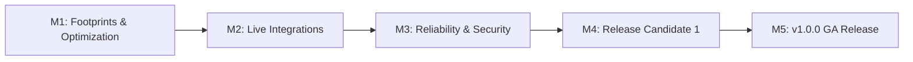

# Central Intelligence — V1 Release Roadmap & Milestone Verification Gates

**Author:** Principal Software Architect, Release Coordinator & Security Reviewer  
**Repository:** `Aashish-RC/Central-Intelligence`  
**Working Revision:** `1269bf30a1f33ab2fad95fc58e6ab4274891c16f`  
**Date:** 2026-11-17  
**Status:** **AUTHORITATIVE RELEASE MANAGEMENT ROADMAP**

---

## 1. Governance Principles & Strict Release Rules

1. **Evidence-Based Completion Only:** No task, integration scenario, or milestone is marked complete merely because code exists, configuration renders, or a mocked test passes. Genuine, non-mocked execution logs against running services are mandatory for live integration claims.
2. **Infrastructure-Dependent Gates Remain Open:** Tasks requiring external infrastructure, live databases, or third-party credentials remain in status 🟡 PARTIAL until executed and verified.
3. **Hardware Capacity Protection:** Never attempt to start all 37 core services simultaneously on an 8 GB developer machine. Service integrations must be verified in controlled, sequential batches within memory limits.
4. **No Unauthorized Deployments:** Kamal deployment tests remain simulated in automated CI until explicit deployment authorization and dedicated infrastructure are provided.
5. **Zero Paid Invocations Without Approval:** No LLM reasoning API calls, paid cloud sandboxes, or hosted services may be executed without explicit sign-off.
6. **Explicit Release Authorization:** Release Candidate 1 (RC1) and Production v1.0.0 General Availability (GA) require formal review and explicit authorization.

---

## 2. Release Milestones & Quality Gates

---

### Milestone M1: Infrastructure Optimization, Footprint Profiles & Governance
**Target Completion:** Immediate / Sprint 1  
**Status:** **IN PROGRESS (High Confidence Quick Wins Implemented)**  
**Objective:** Eliminate container memory crashes (Exit Code 137), establish backwards-compatible Compose profiles (`lite`, `standard`, `enterprise`), enforce container resource limits, and implement governed capability-driven dynamic activation.

#### Entry Criteria:
- Repository at clean revision `1269bf30a1f33ab2fad95fc58e6ab4274891c16f`.
- Python offline test suite passes (1,195 passed, 1 skipped, 125 deselected).
- TypeScript test suites pass (336 passed across 4 packages).
- License audit passes (45 Compose services verified).

#### Deliverables:
1. `docs/optimization/V1_RESOURCE_BASELINE.md`
2. `docs/optimization/V1_SERVICE_DEPENDENCY_MATRIX.md`
3. `docs/optimization/V1_OPTIMIZATION_DECISIONS.md`
4. `docs/optimization/V1_DEPLOYMENT_FOOTPRINTS.md`
5. `docs/optimization/V1_RESOURCE_BENCHMARKS.md`
6. `docs/V1_MASTER_PROGRESS_TRACKER.md`
7. `platform_infra/compute/lifecycle/capability_activation.py` + unit tests
8. Multi-profile `docker-compose.yml` with strict memory limits

#### Exit Criteria:
- `docker compose --profile lite config --quiet` renders valid configuration.
- `docker compose --profile core config --quiet` renders with 100% backwards compatibility.
- `scripts/check_licenses.py` executes cleanly with 0 errors.
- Capability activation engine passes full test suite including idle draining and active work protection.

---

### Milestone M2: Staged Live Service Integrations & Quarantine Closure
**Target Completion:** Sprint 2  
**Status:** **OPEN — Pending Disposable Environment Execution**  
**Objective:** Replace mocked and fail-closed tests across the 11 historical integration scenarios with real service execution and state persistence across restarts.

#### Entry Criteria:
- M1 successfully verified.
- Access to GitHub Codespace (4 vCPU, 16 GB RAM) or confirmed disposable local database environment.
- Process environment variables configured for test execution without committing secrets.

#### Execution Groups (Controlled Sequential Batches):
- **Batch 1 (Core Storage & State):** `supabase-db` (Postgres relational + pgvector), `valkey` (caching/leases), `qdrant` (vector ANN), `apache-age` (graph queries). Verify data survives container recreation.
- **Batch 2 (Identity, Security & Governance):** `openfga` (with Postgres datastore + migrations), `infisical` (secret lifecycle + revocation), `bytebase` (DDL migration execution).
- **Batch 3 (Workflow & Execution):** `temporal` (workflow survives worker crash and resumes deterministically), local Docker sandbox (untrusted Python execution with cgroup limits).
- **Batch 4 (Billing & Metering Pipeline):** `lago` (on `agpl_quarantine_net`, subscription lifecycle), `openmeter` (Kafka ingestion + ClickHouse persistence).
- **Batch 5 (Surface & Telemetry):** `otel-collector` (trace batch export), `signoz` (trace query verification), `librechat` (authenticated chat through reasoning gateway).

#### Exit Criteria:
- 11 of 11 live integration scenarios report genuine pass evidence in `docs/verification/02_LIVE_INTEGRATION_CLOSURE.md`.
- Zero skipped or mocked tests counted as live passes.

---

### Milestone M3: Reliability, Soak, Fault Injection & Security Hardening
**Target Completion:** Sprint 3  
**Status:** **NOT STARTED**  
**Objective:** Prove Central Intelligence maintains stability under sustained load, memory limits, network partitioning, and adversarial penetration attempts.

#### Entry Criteria:
- M2 live integrations verified.
- Load testing harness (`tests/load/`) operational.

#### Deliverables & Exercises:
1. **24-Hour Continuous Soak Test:** Run Central Intelligence Standard profile under simulated multi-tenant message load. Verify zero memory leaks, unbounded buffer growth, or OOM crashes.
2. **Chaos Engineering & Crash Recovery Drill:** Inject unexpected SIGKILL terminations into `supabase-db`, `valkey`, `temporal`, and `qdrant`. Verify state machine auto-recovery, WAL replay, and zero data corruption.
3. **Cross-Tenant Security Boundary Audit:** Execute automated penetration suite testing for:
   - Tenant context injection in vector embeddings.
   - Unauthorized OpenCypher graph traversals across tenant boundaries.
   - ReBAC permission leaks.
   - Host filesystem escape attempts from sandbox containers (all 45 attack vectors).
4. **Supply Chain Audit:** Re-run `pip-audit`, `npm audit`, and license checkers with zero allowed CVEs.

#### Exit Criteria:
- Zero memory leaks over 24-hour soak test.
- 100% crash recovery success without orphaned state.
- Zero high/critical security findings or tenant isolation bypasses.

---

### Milestone M4: Release Candidate 1 (RC1) Verification & Consolidation
**Target Completion:** Sprint 4  
**Status:** **NOT STARTED**  
**Objective:** Consolidate all engineering evidence, verify release documentation, freeze code, and prepare the RC1 candidate for stakeholder review.

#### Entry Criteria:
- M1, M2, and M3 fully closed and verified.
- Zero unresolved P0 (Critical) or P1 (High) defects in `docs/CRITICAL_DEFECT_REGISTER.md`.

#### Deliverables:
1. Complete regression run across Python (all versions), TypeScript, and Compose stack.
2. `docs/CRITICAL_RELEASE_GATE_REPORT.md` updated with empirical execution evidence.
3. Formal 19-layer operational readiness scorecard sign-off.
4. Release candidate tag `v1.0.0-rc1` created upon authorization.

#### Exit Criteria:
- 100% pass rate across entire automated test matrix (>1,600 tests).
- All 45 items in `docs/PROJECT_12_SECTION_CHECKLIST.md` verified with evidence.
- Written release authorization from product and engineering leadership.

---

### Milestone M5: General Availability (GA) v1.0.0 Production Release
**Target Completion:** Sprint 5  
**Status:** **NOT STARTED**  
**Objective:** Tag official release, publish immutable release artifacts, verify clean installation runbooks, and activate production monitoring.

#### Entry Criteria:
- RC1 soak period completed with zero release-blocking defects reported.
- Clean installation drill verified on fresh virtual machine.

#### Execution:
1. Lock release commits and generate SHA-256 digests for all container images and packages.
2. Publish official `v1.0.0` release tag and release notes.
3. Validate production deployment and smoke tests.
4. Handover to operations and customer onboarding.
