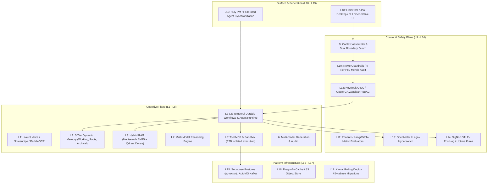

# Central Intelligence Architecture Specification (Layers 1–19)

**Document Version:** 1.0.0  
**Target:** Aevum CI Brain Architecture  
**Status:** Hardened Production Reference

---

## 1. Architectural Overview

Central Intelligence is an enterprise-grade cognitive AI operating system structured into **19 hierarchical layers** organized across four primary planes:
1. **Cognitive Plane (L1–L8):** Perception, Memory, Knowledge, Reasoning, Action, Generation, Orchestration, and Autonomous Agent Runtime.
2. **Control & Safety Plane (L9–L14):** Context Engineering, Safety & Guardrails, Evaluation & Observability, Identity & Zanzibar ReBAC Access Control, Billing & Metering, and Unified Telemetry.
3. **Platform Infrastructure Plane (L15–L17):** Distributed Data & Messaging, Storage & In-Memory Compute, CI/CD Zero-Downtime Releases, and Migration Management.
4. **Surface & Federation Plane (L18–L19):** Multi-modal user interfaces (Web, Desktop, CLI, Generative UI widgets) and Peer Federation (Huly PM, Cross-Agent Memory Sync, Distributed Consensus).

---

## 2. Layer-by-Layer Architectural Breakdown

### 2.1 Layer 1: Perception
- **Capabilities:** Real-time multi-modal streaming inputs across audio, vision, screen capture, and document parsing.
- **Key Integrations:** LiveKit (WebRTC voice pipelines), PaddleOCR (document text extraction), Crawl4AI (deep web spidering), Screenpipe (real-time desktop visual capture).
- **Hardening:** Adapters fail-closed if missing live endpoints in production mode.

### 2.2 Layer 2: Memory Hierarchy
- **Architecture:** 3-tier fused memory architecture:
  - **Tier 1 (Working Memory):** High-speed in-memory buffer with write-ahead log (WAL) persistence for active turns.
  - **Tier 2 (Structured Facts):** Relational store (SQLite / PostgreSQL) managing atomic facts, versioning, confidence scoring, and conflict resolution.
  - **Tier 3 (Semantic Archival):** Dense vector index (Qdrant / Chroma) powered by local or cloud embedding models for semantic recall.
- **Access Control:** OpenFGA ReBAC hook pre-filters write and read access per user/tenant scope.

### 2.3 Layer 3: Knowledge & Retrieval (Hybrid RAG)
- **Architecture:** Reciprocal Rank Fusion (RRF) combining sparse BM25 indexing (Meilisearch) and dense semantic vector search (Qdrant).
- **Reranker:** Local cross-encoder reranking tier maximizing top-5 retrieval precision.

### 2.4 Layer 4–6: Reasoning, Action & Generation
- **Execution Sandboxing:** E2B isolated cloud micro-containers executing arbitrary Python, Node.js, and shell scripts without host risk.
- **Model Context Protocol (MCP):** Dynamic tool binding enabling agents to discover and invoke tools over standard protocol interfaces.
- **Generative UI:** Dynamic creation of interactive HTML/Mermaid widgets rendered directly on user surfaces.

### 2.5 Layer 7–8: Durable Orchestration & Agent Runtime
- **Temporal Engine:** Durable workflow execution engine ensuring long-running agent workflows survive process crashes, server restarts, and transient network failures.
- **Agent Blueprints:** Pre-compiled declarative manifests for specialised personas (Coder, Researcher, Auditor).

### 2.6 Layer 9–10: Context Engineering & Safety Guardrails
- **Dual Boundary Assembler:** Encapsulates untrusted user instructions and external retrieved content within cryptographic `<untrusted_content source="..." trust="...">` XML tags, neutralizing jailbreaks and prompt injection.
- **NeMo Guardrails:** Policy enforcement evaluating input/output tokens against safety rubrics.
- **4-Tier PII Scrubber:** Regex, Named Entity Recognition, and tokenized masking of sensitive identifiers.
- **Unified Merkle Audit Ledger:** Cryptographic append-only ledger computing SHA-256 Merkle root hashes for every critical action.

### 2.7 Layer 11–14: Evaluation, Identity, Billing & Observability
- **Keycloak & OpenFGA:** Centralized OIDC identity federation and Zanzibar fine-grained relation tuples.
- **Billing Stack:** OpenMeter (real-time token and compute metering), Lago (quarantined AGPL billing engine), Hyperswitch (universal payment orchestration).
- **Observability:** SigNoz OpenTelemetry collector, PostHog product telemetry, and Uptime Kuma heartbeats.

### 2.8 Layer 15–17: Platform Infrastructure & Release
- **Storage & Messaging:** Supabase PostgreSQL with `pgvector` and Apache AGE graph extensions; AutoMQ Kafka-compatible event streaming; Dragonfly high-throughput in-memory cache.
- **Deployment & Migrations:** Kamal containerized zero-downtime rolling deployments; Bytebase schema migration pipeline with automated rollback verification.

### 2.9 Layer 18–19: Surface Interfaces & Federation
- **Interaction Surfaces:** LibreChat web frontend, Jan desktop local AI client, CLI terminal interfaces.
- **Federation:** Huly project management synchronization and decentralized cross-agent task coordination.

---

## 3. Crown Jewel Defense Mechanisms

1. **Production Safety Guard (`control/safety/production_guard.py`):**
   Prevents silent fallbacks to mock or simulated drivers when running under live deployment or `ADAPTER_MODE=live`.
2. **Dual-Boundary Prompt Injection Filter:**
   Guarantees that third-party data or untrusted inputs cannot alter system persona or tool-calling directives.
3. **Cryptographic Merkle Tree Ledger:**
   Provides mathematically verifiable audit history ensuring zero unauthorized log alterations.
