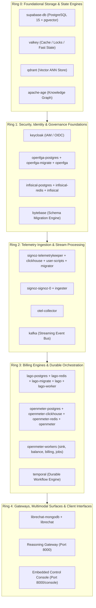

# V1 Service Dependency Matrix & Topology

**Author:** Principal Software Architect & QA Lead  
**Repository:** `Aashish-RC/Central-Intelligence`  
**Working Revision:** `1269bf30a1f33ab2fad95fc58e6ab4274891c16f`  
**Date:** 2026-11-17  
**Status:** **AUTHORITATIVE TOPOLOGY SPECIFICATION**

---

## 1. Startup Ring Architecture (Tiered Orchestration Rings)

To eliminate race conditions, cascading restarts, and memory spikes during stack initialization, services are partitioned into five strictly ordered startup rings. No ring may begin initialization until all prerequisite services in preceding rings report `service_healthy` or `service_completed_successfully`.

---

## 2. Complete Inter-Service Dependency Graph

| Service Name | Ring | Direct Depends On | Dependency Condition | Runtime Communication Pathway | Fallback / Fail-Closed Behavior |
|---|:---:|---|---|---|---|
| `supabase-db` | 0 | None | N/A | PostgreSQL Wire (`5432/tcp`) | **SPOF for relational data.** Hard fail if down. |
| `valkey` | 0 | None | N/A | Redis RESP (`6379/tcp`) | Soft fallback: In-process memory cache & file locks. |
| `qdrant` | 0 | None | N/A | HTTP REST (`6333`), gRPC (`6334`) | Soft fallback: pgvector relational vector fallback. |
| `apache-age` | 0 | None | N/A | PostgreSQL Wire (`5432/tcp` on host `5433`) | Soft fallback: In-memory networkx graph adapter. |
| `keycloak` | 1 | `supabase-db` (in unified) | `service_healthy` | HTTP REST / OIDC (`8080/tcp` on host `8085`) | Soft fallback: Internal JWT and local API keys. |
| `openfga-postgres` | 1 | None | N/A | PostgreSQL Wire (`5432/tcp`) | Hard fail for standalone OpenFGA storage. |
| `openfga-migrate` | 1 | `openfga-postgres` | `service_healthy` | PostgreSQL DDL | One-shot job. Must succeed before OpenFGA boots. |
| `openfga` | 1 | `openfga-postgres`, `openfga-migrate` | `service_healthy`, `service_completed` | HTTP REST (`8080/tcp`), gRPC (`8081/tcp`) | Fail-closed: Denies unauthorized access on failure. |
| `infisical-postgres` | 1 | None | N/A | PostgreSQL Wire (`5432/tcp`) | Hard fail for standalone Infisical datastore. |
| `infisical-redis` | 1 | None | N/A | Redis RESP (`6379/tcp`) | Hard fail for Infisical cache. |
| `infisical` | 1 | `infisical-postgres`, `infisical-redis` | `service_healthy` | HTTP REST (`8080/tcp` on host `8083`) | Soft fallback: Local AES-256 encrypted keystore / `.env`. |
| `bytebase` | 1 | None | N/A | HTTP REST (`8080/tcp` on host `5678`) | On-demand: Dev migrations run via local scripts. |
| `kafka` | 2 | None | N/A | Kafka binary protocol (`9092`, `29092`) | Soft fallback: Direct synchronous REST billing. |
| `signoz-telemetrykeeper` | 2 | None | N/A | ClickHouse Keeper Raft (`9181/tcp`) | Hard fail for SigNoz ClickHouse cluster. |
| `signoz-telemetrystore-scripts`| 2 | None | N/A | ClickHouse client script | One-shot initialization script. |
| `signoz-telemetrystore-clickhouse` | 2 | `signoz-telemetrykeeper`, `user-scripts` | `service_healthy`, `service_completed` | ClickHouse native (`9000`), HTTP (`8123`) | Hard fail for SigNoz telemetry storage. |
| `signoz-telemetrystore-migrator` | 2 | `signoz-telemetrystore-clickhouse` | `service_healthy` | ClickHouse DDL | One-shot schema migrator. |
| `signoz-signoz-0` | 2 | `signoz-metastore-postgres`, `clickhouse`, `migrator` | `service_healthy`, `service_completed` | HTTP REST / Web (`8080/tcp` on host `3301`) | Non-blocking: Observability UI down does not halt core. |
| `ingester` | 2 | `signoz-signoz-0`, `clickhouse`, `migrator` | `service_healthy`, `service_completed` | OTLP gRPC (`4317`), HTTP (`4318`) | Drops traces to memory queue with bounded buffer. |
| `otel-collector` | 2 | `ingester` | `service_healthy` | OTLP gRPC (`4317`), HTTP (`4318`) | Memory limiter backpressure; drops old spans. |
| `lago-postgres` | 3 | None | N/A | PostgreSQL Wire (`5432/tcp`) | Hard fail for Lago database. |
| `lago-redis` | 3 | None | N/A | Redis RESP (`6379/tcp`) | Hard fail for Lago Sidekiq queues. |
| `lago-migrate` | 3 | `lago-postgres`, `lago-redis` | `service_healthy` | Rails DDL migration | One-shot migration. |
| `lago` | 3 | `lago-postgres`, `lago-redis`, `lago-migrate` | `service_healthy`, `service_completed` | HTTP REST (`3000/tcp` on host `3002`) | Fail-closed: Metered requests blocked if billing down. |
| `lago-worker` | 3 | `lago` | `service_healthy` | Redis Sidekiq queue | Async tasks queue in Redis; retries automatically. |
| `openmeter-postgres` | 3 | None | N/A | PostgreSQL Wire (`5432/tcp`) | Hard fail for OpenMeter configuration. |
| `openmeter-clickhouse` | 3 | None | N/A | ClickHouse native (`9000`), HTTP (`8123`) | Hard fail for OpenMeter real-time aggregation. |
| `openmeter-redis` | 3 | None | N/A | Redis RESP (`6379/tcp`) | Hard fail for OpenMeter deduplication driver. |
| `openmeter` | 3 | `kafka`, `openmeter-clickhouse`, `openmeter-postgres` | `service_healthy` | HTTP REST (`8888/tcp`) | Fail-closed: Drops unmetered calls unless BYOK. |
| `openmeter-sink-worker` | 3 | `kafka`, `clickhouse`, `openmeter`, `redis` | `service_healthy` | Kafka consumer loop | Commits Kafka offset; durable replay on restart. |
| `openmeter-balance-worker`| 3 | `kafka`, `clickhouse`, `openmeter`, `redis` | `service_healthy` | Kafka consumer loop | Re-evaluates balance ledger upon worker restart. |
| `openmeter-billing-worker`| 3 | `kafka`, `clickhouse`, `openmeter` | `service_healthy` | Kafka consumer loop | Auto-recovery on restart. |
| `openmeter-jobs` | 3 | `openmeter`, `kafka`, `clickhouse`, `postgres` | `service_healthy` | Cron / Job runner | Idempotent table partition maintenance. |
| `temporal` | 3 | None | N/A | gRPC (`7233/tcp`), Web UI (`8233/tcp`) | Hard fail for long-running durable workflows. |
| `librechat-mongodb` | 4 | None | N/A | MongoDB Wire (`27017/tcp`) | Hard fail for LibreChat sessions. |
| `librechat` | 4 | `librechat-mongodb` | `service_healthy` | HTTP Web (`3080/tcp`) | Headless API remains 100% operational. |

---

## 3. Cross-Layer Capability Mapping Matrix (Layers 1–19)

| Layer | Architecture Domain | Mandatory Service Dependencies | Optional / Hot-Swappable Services | Fallback Engine In-Repo |
|---|---|---|---|---|
| **L1 Perception** | Vision, Audio, Multimodal Stream | None (In-process PyTorch/PIL) | `livekit` (WebRTC SFU) | Local PIL, OpenCV heuristics, WebRTC stub |
| **L2 Memory** | Working, Episodic, Semantic, Graph | `valkey`, `supabase-db` | `qdrant`, `apache-age`, `falkordb`, `memgraph`, `chroma` | SQLite fact store, Python in-memory NetworkX |
| **L3 Knowledge** | Hybrid RAG, BM25, Access Filtering | `supabase-db` (pgvector) | `qdrant`, `apache-age`, `meilisearch` | SQLite FTS5, Scikit-learn cosine sim |
| **L4 Reasoning** | Planning, Routing, Synthesis | None (LLM REST / In-process) | `ollama` (Local LLM) | Rule-based planner, deterministic fallbacks |
| **L5 Action** | Tool Execution, Sandbox Containers | Local Docker/Podman Engine | Remote Sandbox API | Windows Job Objects, Linux namespaces |
| **L6 Generation** | Streaming, Structured Output | None (In-process Engine) | `ollama` | Internal formatting & schema validators |
| **L7 Durable Exec** | Checkpointing, Workflow Replay | `temporal` | In-process SQLite orchestrator | File-based checkpoint store (`.temporal_checkpoints`) |
| **L8 Multi-Agent** | Agent Fleet, Swarm Delegation | `valkey` (Leases) | In-memory lease table | Process-isolated threading lock manager |
| **L9 Context Eng** | Dynamic Context Window, Scratchpad | None (In-process Engine) | `huly` (Collaboration) | In-memory token-bounded context builder |
| **L10 Safety** | Crown Jewel Defense, Prompt Guard | None (In-process Governor) | `svix` (Webhooks) | `SecurityGovernor`, Regex boundary guards |
| **L11 Evaluation** | Evals, Benchmarks, Red Teaming | None (In-process Runner) | `phoenix` (Arize AI) | Built-in scenario evaluators |
| **L12 Identity** | ReBAC, Multi-Tenancy, Secrets | `openfga`, `infisical` | `keycloak` | Built-in RBAC, AES-256 encrypted keystore |
| **L13 Billing** | Usage Metering, Subscription Invoicing | `openmeter`, `lago` | `hyperswitch` (Payment gateway) | Local SQLite metering, BYOK bypass |
| **L14 Telemetry** | APM Traces, Metrics, Logs | `otel-collector` | `signoz` (Full suite), `posthog`, `uptime-kuma` | Console logger, local rotating JSON log |
| **L15 Platform** | DB Migrations, Container Runtimes | `supabase-db` | `bytebase` | Alembic / custom SQL migration runner |
| **L16 Compute** | Model Catalog, Hot-Swapping, Limits | None (In-process Manager) | Cloud inference providers | Dynamic model routing table, fallback chains |
| **L17 Release** | Deprecation, Rollback, Blue/Green | None (CI/CD scripts) | Kamal, Coolify | Automated rollback guard scripts |
| **L18 Surface** | Web Chat, UI Canvas, Diagrams | None (REST / WebSocket API) | `librechat`, `librechat-mongodb` | Embedded console HTML (`/console`), CLI |
| **L19 Federation** | Model Context Protocol (MCP), A2A | None (In-process MCP Server) | External MCP hosts | STDIO / SSE in-process protocol drivers |

---

## 4. Single Points of Failure (SPOF) & Mitigation Strategy

1. **`supabase-db` (PostgreSQL 15 + pgvector):**
   - *Risk:* Failure halts all relational transactions, tenant verification, and embedding storage.
   - *Mitigation:* Automated connection pooling with health check retries, SQLite snapshot fallback for read-only memory, and WAL replication in Enterprise.
2. **`valkey` (Distributed State & Leases):**
   - *Risk:* Failure disrupts task lease acquisition, rate limits, and semantic query cache.
   - *Mitigation:* Automatic failover to local in-process `threading.Lock` and LRU cache.
3. **`openfga` (ReBAC Engine):**
   - *Risk:* Failure halts authorization checks.
   - *Mitigation:* Security policies fail-closed. Local caching of active tuple grants with bounded TTL (30s) prevents API stampedes.
4. **`temporal` (Workflow State Machine):**
   - *Risk:* Workflow steps cannot checkpoint or resume.
   - *Mitigation:* Durable filesystem checkpoint fallback (`.temporal_checkpoints`) guarantees workflow continuity during server downtime.
